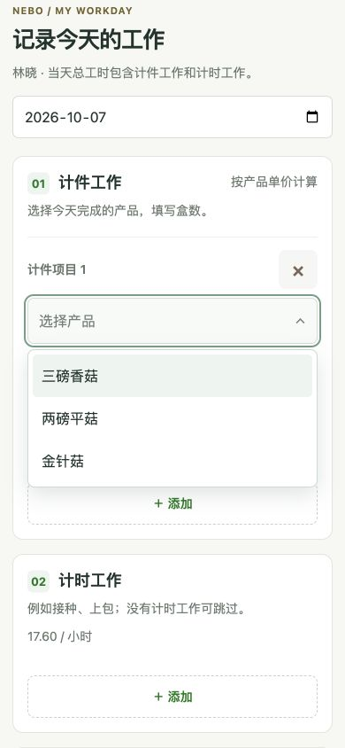
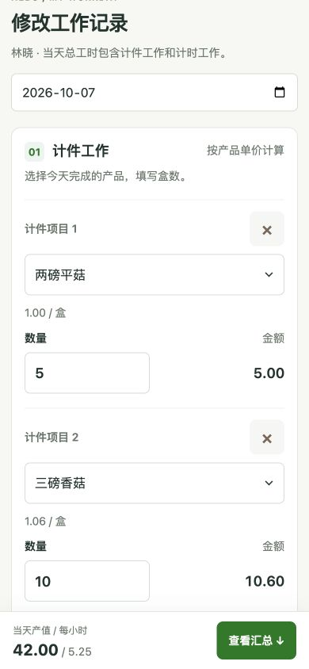
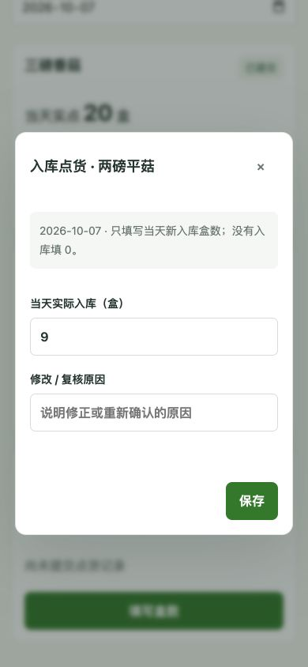
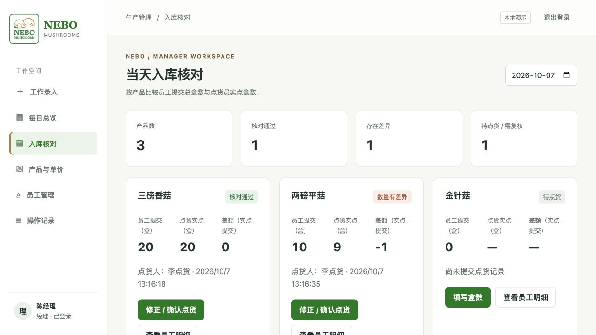
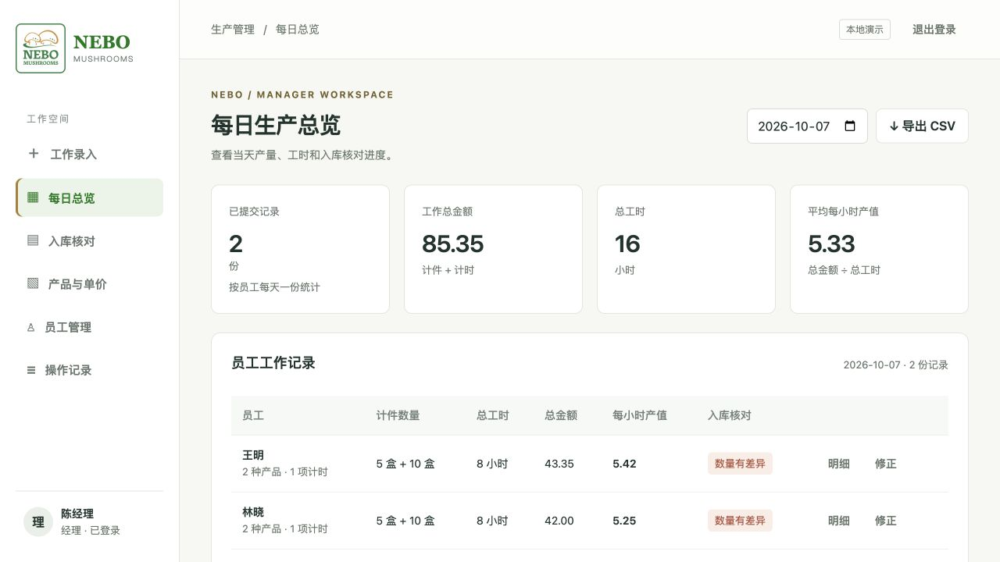
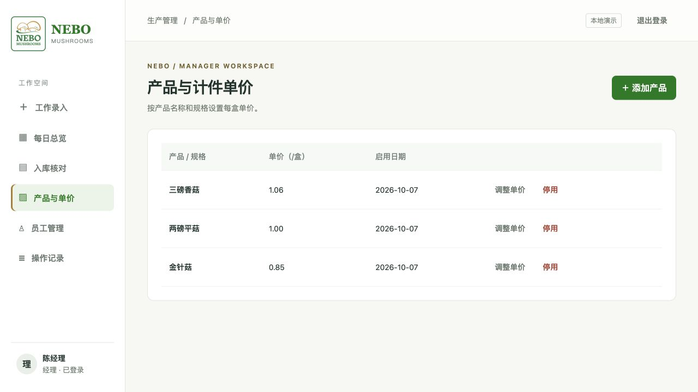
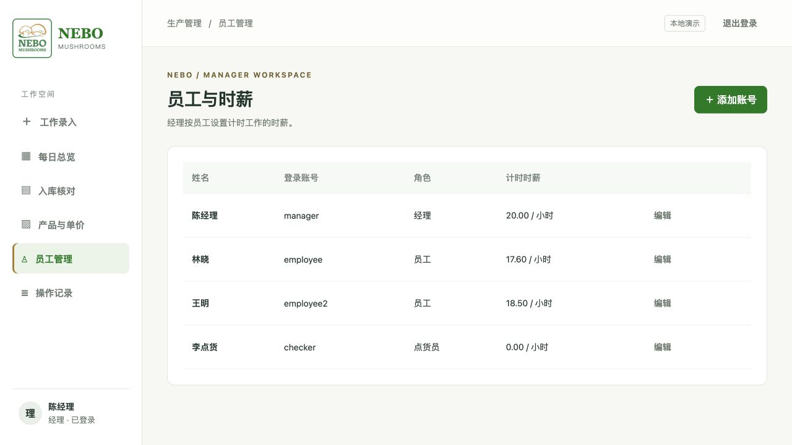

## 目录

1. [先了解操作逻辑](#1-先了解操作逻辑)
2. [登录系统](#2-登录系统)
3. [员工：填写当天工作](#3-员工填写当天工作)
4. [员工：查看和修正记录](#4-员工查看和修正记录)
5. [点货员：记录当天入库](#5-点货员记录当天入库)
6. [老板：核对报数与入库](#6-老板核对报数与入库)
7. [老板：查看产值与导出](#7-老板查看产值与导出)
8. [经理：维护产品与账号](#8-经理维护产品与账号)
9. [经理：追溯操作记录](#9-经理追溯操作记录)

## 1. 先了解操作逻辑

每天的流程是：

1. **员工报数**：选择产品规格，填写完成盒数、计时工作和计件工时，提交当天记录。
2. **点货员实点**：独立清点当天新入库的产品，逐项填写当天累计入库盒数。
3. **老板核对**：按日期和产品，对照员工提交合计与实点盒数。
4. **发现差异后复查**：核实员工报数及实物点货；相关人员修正记录，再重新确认点货。

| 角色 | 主要入口 | 可以做什么 |
| --- | --- | --- |
| 员工 | 工作录入、我的记录 | 提交每日产品盒数和工时；查看产值；修正自己的日报 |
| 点货员 | 入库核对 | 填写、修正或重新确认当天实际入库盒数；查看点货人和时间 |
| 老板 / 经理 | 每日总览、入库核对、产品与单价、员工管理、操作记录 | 查看全部日报、差额与员工明细；修正记录；导出；维护账号和产品 |

点货员页面不显示员工报数、差额、单价、时薪或产值，便于独立点货。员工只能查看和修正自己的日报。

**日期怎么用：**工作录入、我的记录、每日总览和入库核对按日期查看。产品与单价、员工管理、操作记录不需要选择工作日期，因此没有右上角日期选择器。

## 2. 登录系统

打开公司提供的系统地址，输入自己的账号、密码，点击 **“登录工作台 →”**。三种角色共用这个登录页，系统根据账号自动显示相应功能；点货员登录后直接进入入库点货。

## 3. 员工：填写当天工作

### 3.1 确认日期，选择产品和盒数

进入 **“工作录入”**，先确认日期。计件工作不默认生成空行，需要时点击 **“＋ 添加”**，选择今天完成的产品规格，再填写盒数。

例如：两磅平菇 `5` 盒、三磅香菇 `10` 盒。员工不需要输入 Lot number；同一产品选过后，不会再出现在其他新行的可选列表中，避免重复填报。选错项目可点击该行的 **“×”** 移除。

产品名称由经理维护，请按完整规格选择。数量填写盒数，不填蘑菇个数或重量。下图展示手机端实际产品下拉菜单。

### 3.2 填写计时工作和当天工时

有接种、上包等计时工作时，在 **“计时工作”** 点击 **“＋ 添加”**，填写小时数和工作备注。没有计时工作可以跳过；有多项时可分别添加，系统自动汇总时长。

在 **“当天总工时”** 中，只手动填写 **计件工时**。右侧的计时工时来自上方项目自动相加，不要把计时工时再次填入左侧。

| 输入内容 | 示例 |
| --- | --- |
| 计时工作 | 接种、上包，1.5 小时 |
| 手动填写计件工时 | 6.5 小时 |
| 系统计算当天总工时 | 6.5 + 1.5 = 8 小时 |

仅做计时工作时，计件工时可以留空。下图是已有日报进入修正后的实际表单，工时填写方式与首次录入相同。

### 3.3 检查金额，再提交

向下查看汇总区，确认产品、盒数、工时无误后，首次录入点击 **“提交今日记录 →”**。每位员工每天提交一份记录；已提交后通过“修正”更新，不用重复新建。

计算方式如下，示例使用林晓的记录：

| 指标 | 计算方式 | 示例结果 |
| --- | --- | --- |
| 计件金额 | 各产品盒数 × 对应每盒单价，再相加 | 5 × 1.00 + 10 × 1.06 = 15.60 |
| 计时金额 | 计时小时合计 × 个人计时时薪 | 1.5 × 17.60 = 26.40 |
| 当天工作产值 | 计件金额 + 计时金额 | 42.00 |
| 当天总工时 | 计件工时 + 计时工时 | 8 小时 |
| 平均每小时产值 | 当天工作产值 ÷ 当天总工时 | 5.25 / 小时 |

**工作产值用于生产效率参考，不等于工资结算。** 页面中的个人计时时薪用于计时金额计算，平均每小时产值则是当天全部工作计算出的结果。

下图是同一汇总区的**修正模式**，所以按钮显示“保存修正”和“取消修改”；首次录入显示提交按钮。

## 4. 员工：查看和修正记录

### 4.1 查看自己的日报

点击 **“我的记录”**，选择工作日期，查看该日的产品盒数、计时备注、总工时、金额和入库核对状态。手机页面向下滑动可以看到完整明细和 **“修正工作记录”** 按钮。

例如下图中，林晓当天已提交 1 份记录，总金额 42.00，总工时 8 小时。显示“数量有差异”说明涉及的产品需要复查，不能仅凭这个标签判断是该员工填错。

### 4.2 修改填错的内容

点击 **“修正工作记录”** 后，原来的数量、工时和备注会带回表单。导航及页面标题变为 **“修改工作记录”**，帮助确认当前正在修改已有日报。

修改需要调整的项目，填写 **“修改原因”**，检查汇总金额后点击 **“保存修正 →”**。不想保留本次改动时点击 **“取消修改”**。保存或取消后，导航恢复“工作录入”。经理也可以在员工日报中发起修正。

原有产品单价与个人时薪沿用提交时的记录，后续调价不会自动改写历史金额。下图展示实际进入修正后的页面；本次截图后已取消，未改变演示报数。

如果修正改变了已点货产品的数量，该产品会变成 **“需重新核对”**。原实点数仍保留，需要点货员或经理重新确认；只改计时备注不会触发产品数量复核。

## 5. 点货员：记录当天入库

### 5.1 选择日期，逐项清点

点货员登录后进入 **“当天入库点货”**。确认日期，对照实际货物清点每种产品当天新入库的总盒数，再点击 **“填写盒数”**。

这里填写的是**当天生产的新入库数量**，不包括以前的存货，也不减掉当天发出的货。尚未填写显示“待点货”；当天确实没有入库时，应明确填写 `0`。

下图是尚未提交点货时的实际页面。点货员看不到员工提交合计，按自己的实点结果填写即可。

### 5.2 输入当天累计总数并保存

弹窗会显示产品名称和日期。在 **“当天实际入库（盒）”** 输入非负整数，点击 **“保存”**。例如三磅香菇当天共入库 `20` 盒，就填写 `20`。

每个日期、每种产品只有一条点货总数，多名点货员共用这条结果。**保存的是当天总数，不是在原来数字上追加。** 例如上午共 8 盒、下午又入库 12 盒，更新时应填当天总数 `20`，不能只填 `12`。

### 5.3 修正或重新确认点货

已经保存的产品会显示实点盒数、点货人和时间。要改正数量或重新复核，点击 **“修正 / 确认点货”**，填写正确的当天总数，以及 **“修改 / 复核原因”**，再保存。

例如重新清点确认原来漏记了一盒，可把 `9` 改为 `10`，原因写“重新清点，补记漏计的1盒”。如果数量仍为 `9`，也可以保留原数，写明复核原因后确认。下图仅展示已保存 9 盒的修正表单，尚未提交修改。

如果打开表单后，其他人已经修改该点货记录，或员工报数发生变化，系统会提示刷新后重新确认，避免旧页面覆盖新结果。

## 6. 老板：核对报数与入库

### 6.1 看每种产品是否一致

进入 **“入库核对”**，选择日期，逐项查看员工提交合计、点货实点、差额、点货人和时间。

**差额 = 当天实际入库盒数 − 当天员工提交盒数合计。** 负数表示实点比报数少，正数表示实点比报数多。

| 演示产品 | 员工提交 | 点货实点 | 结果 |
| --- | --- | --- | --- |
| 三磅香菇 | 20 盒 | 20 盒 | 核对通过 |
| 两磅平菇 | 10 盒 | 9 盒 | 差额 −1 盒，数量有差异 |
| 金针菇 | 0 盒 | 未填写 | 待点货；未填写不等于 0 |

### 6.2 查看差异涉及哪些员工

点击产品下的 **“查看员工明细”**，查看每位员工对此产品提交的盒数。下图中，两磅平菇共 10 盒，王明和林晓各提交 5 盒。

发现差额后，先核实产品规格、日期、员工数量和实物点货。系统显示差异，供大家复查，不会自动认定谁填错，也不会自动把员工数量改成实点数量。

### 6.3 理解核对状态

| 状态 | 含义 | 下一步 |
| --- | --- | --- |
| 待点货 | 该产品当天还没有实际入库数 | 点货员填写；无入库则填 0 |
| 核对通过 | 已确认的实点数与员工合计一致 | 保留记录，继续检查其他产品 |
| 数量有差异 | 实点数与员工报数不相等 | 复查报数和点货，按实际情况修正 |
| 需重新核对 | 点货后该产品的员工报数发生变化 | 重新核实当天总数，填写原因并确认 |

## 7. 老板：查看产值与导出

进入 **“每日总览”** 并选择日期，顶部展示已提交份数、工作总金额、总工时及平均每小时产值。下方按员工列出当日数量、金额、工时和核对状态；点击 **“明细”** 看具体项目，点击 **“修正”** 修改该员工日报并填写原因。

点击右上角 **“↓ 导出 CSV”**，导出当前所选日期的工作明细，可使用 Excel 打开。导出内容包括日期、员工、计件或计时类型、产品或备注、数量、单价或时薪、明细金额，以及日报汇总与核对状态；不包含 Lot 列。

下图两名员工共提交 2 份日报，总金额 85.35，总工时 16 小时。总览平均每小时产值按 **总金额 ÷ 总工时** 计算，约为 5.33。

**处理导出数据时：**一份日报可能拆成多条计件、计时明细。当天总工时、当天总金额等日报字段会在各行重复，不能直接把这些列全部相加；应先按“日期 + 员工”去重。明细金额则可以按明细行统计。

## 8. 经理：维护产品与账号

### 8.1 产品与每盒单价

进入 **“产品与单价”**，点击 **“＋ 添加产品”**，填写产品名称与规格、每盒单价、启用日期，再保存。例如名称填“两磅平菇”或“三磅香菇”，让员工明确选择哪一种规格。

启用日期当天就可以用于录入。当前版本不需要 Lot 编号、每盒蘑菇个数或起始库存。

已有产品可以 **“调整单价”** 或 **“停用”**。调价影响后续新录入；停用后不再用于新日报，但已有日报及相关历史核对仍保留。

### 8.2 创建和维护账号

进入 **“员工管理”**，点击 **“＋ 添加账号”**，填写姓名、登录名、初始密码、计时时薪，并选择角色后保存。

| 角色选择 | 配置提示 |
| --- | --- |
| 普通员工 | 填写该员工计时工作的时薪，用于计算其计时金额 |
| 点货员 | 只负责独立点货，计时时薪填 0 |
| 经理 | 可查看全体日报、维护资料、导出和核对 |

已有账号点击 **“编辑”**，可修改姓名、计时时薪或重设密码；不需要重设密码时，密码栏留空。时薪调整不自动追改已提交日报的历史金额。

## 9. 经理：追溯操作记录

进入 **“操作记录”**，查看最近 100 次操作，列表显示操作人、操作时间和操作内容。点击 **“查看变更”**，查看操作对象及“原来 / 现在”的对照；修正操作还会记录修改原因。

下图展示李点货首次提交两磅平菇点货：实际入库从“未点货”变为“9盒”，当时员工提交合计为“10盒”。这些是可读的文字和数字，不需要理解程序数据格式。

