> 旧版存档：含 Lot 和出库的流程已停用，请阅读项目根目录的最新 README。

# NEBO Mushrooms｜产品演示与使用说明

员工每天用手机记录产量与工时，系统即时计算工作产值；经理查看日报、登记出库、核对库存，并追溯每一次修正。

**版本：2026 年 10 月 1 日 · 本地演示版**

本说明的 17 张图片均由当前应用实际操作截图取得，没有使用设计稿或合成界面。姓名、数量和金额为演示样本；手机图为浏览器手机尺寸预览。图片按操作发生时的状态保留，因此会依次出现“提交前、提交后、修正后、盘点后”的变化。

## 一、目前可以做什么

| 使用者 | 功能 |
| --- | --- |
| 员工 | 按日期录入多个 Lot 的计件数量、计时小时和备注；自动汇总工时、金额与平均每小时产值；查看和修正自己的日报 |
| 经理 | 查看全部员工的当日日报和明细、修正记录、导出 CSV；管理账号与时薪、Lot 与单价；登记出库、盘点、查看差异与操作记录 |

**建议演示顺序：** 员工录入 → 查看产值 → 修正记录 → 经理总览 → 出库与盘点 → 查看修改前后对照。首次投入使用时，由经理先建立员工账号及 Lot。

## 二、登录

使用分配的账号和密码，点击“登录工作台”。员工与经理共用同一个登录页，进入后显示各自有权限使用的功能。演示账号如下，密码均为 `Harvest2026!`。

| 角色 | 账号 | 演示姓名 |
| --- | --- | --- |
| 经理 | `manager` | 陈经理 |
| 员工 | `employee` | 林晓 |
| 员工 | `employee2` | 王明 |

图 01：实际登录页，右侧为账号、密码及登录按钮。

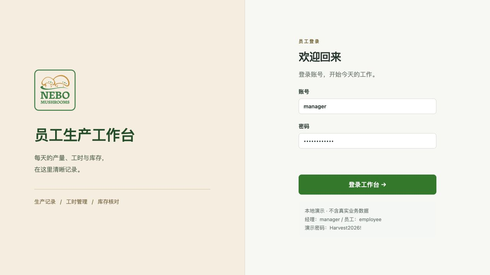

## 三、员工每天如何录入

### 1. 确认工作日期，按需要添加项目

进入“工作录入”，先确认工作日期。计件工作和计时工作最初都不显示空白行，点击对应区域的“＋ 添加”后填写；每类可以添加多项。当天至少需要一项计件或计时工作，不需要的类别可以跳过。补录时选择实际工作的日期，不支持未来日期。

图 02：手机上的初始录入页，下方固定栏可以进入汇总。

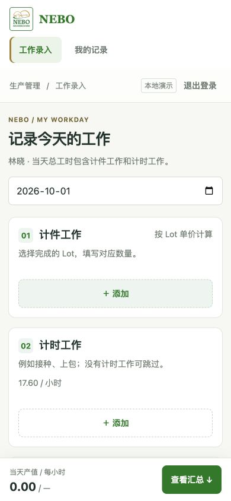

### 2. 选择 Lot，填写完成的盒数

在“计件工作”点击“＋ 添加”，打开 Lot 下拉菜单，选择批次后输入数量。系统显示每盒单价，并自动计算该行金额。同一份记录不能重复选择同一个 Lot；已选批次不会出现在其他行的候选项中。点击该行“×”可移除未提交的项目。

启用日期等于工作日期的 Lot 可以选择；早于启用日期时不会提供该 Lot。已删除的 Lot 不再用于新记录。

本例选择 `SB6QY-J30 · 3lb香菇`，填写 **94 盒**，单价 **1.06 / 盒**，计件金额为 **99.64**。“每盒蘑菇数量”是批次的包装信息，录入数量仍按盒计算，不用再乘每盒蘑菇个数。

图 03：实际展开的 Lot 菜单。

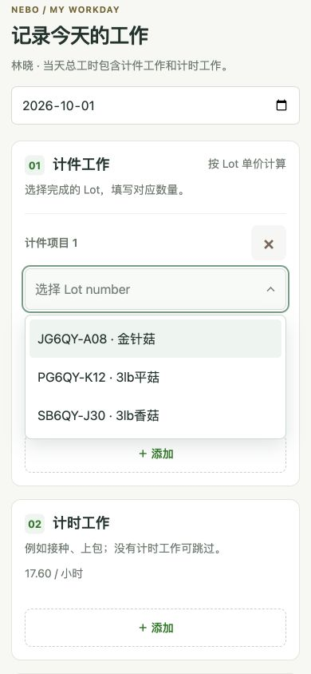

### 3. 填写计时工作与计件工时

在“计时工作”添加小时数和工作备注，例如 **1.5 小时，接种、上包**。多项计时工作会自动相加；时薪由经理设置，员工无需填写单价。

在“当天总工时”中，只填写**计件工作花费的小时数**。右侧自动显示计时工时，系统将两者相加。本例填写 **6.5 小时 + 1.5 小时 = 8 小时**，不要再把 8 填进计件工时框，否则会重复计算。当天只有计时工作时，计件工时可以留空。

图 04：手机上的计时备注与工时自动汇总。

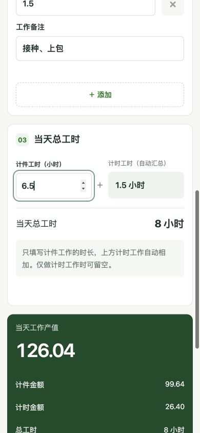

### 4. 检查金额，提交今日记录

点击底部“查看汇总”，检查计件金额、计时金额、总工时及平均每小时产值，再点击“提交今日记录”。金额随输入即时变化，每位员工每天保存一份记录；需要调整时使用修正功能。

| 本例计算 | 结果 |
| --- | --- |
| 计件金额：94 × 1.06 | 99.64 |
| 计时金额：1.5 × 17.60 | 26.40 |
| 当天工作产值：99.64 + 26.40 | 126.04 |
| 总工时：6.5 + 1.5 | 8 小时 |
| 平均每小时产值：126.04 ÷ 8 | 15.76 / 小时（显示至两位小数） |

页面显示的是工作产值，不能直接作为税后工资或工资结算结果。“个人计时时薪参考”显示该员工的时薪，并非统一的绩效目标。

图 05：提交前的实时汇总与提交按钮。

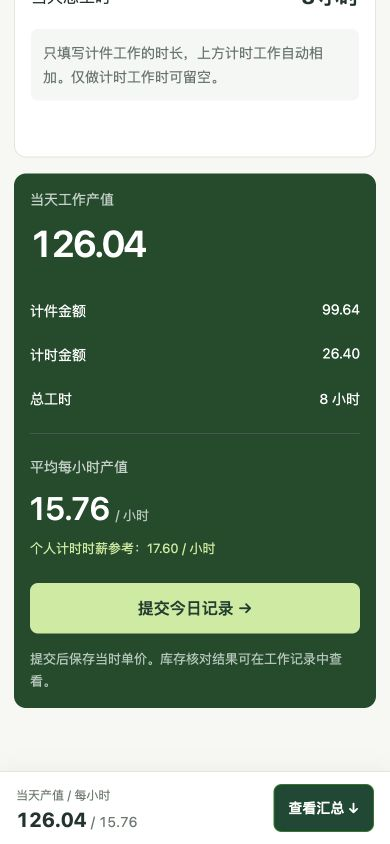

## 四、查看和修正工作记录

### 1. 员工查看自己的记录

进入“我的记录”，选择日期，可看到当日金额、工时、每小时产值及库存核对状态。手机上以卡片展示具体 Lot、数量和计时备注。员工只能查看、修正自己的日报。

图 06：林晓提交后的个人记录，当前库存状态为“待盘点”。

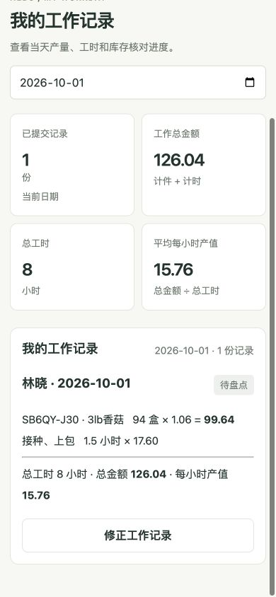

### 2. 发现错误时修正

员工点击“修正工作记录”；经理则在“每日总览”相应行点击“修正”。进入后，导航显示“修改工作记录”。调整数量或工时，填写修改原因，再点击“保存修正”；不保存则点击“取消修改”。保存或取消后，导航恢复“工作录入”。

本例将 **94 盒修正为 96 盒**，原因填写“复核采摘数量：94 盒修正为 96 盒”。计件金额变为 **101.76**，总金额变为 **128.16**，平均每小时产值变为 **16.02**。

原有 Lot 单价和计时时薪沿用提交时的价格；修正中新增的 Lot 使用当时的当前单价。如果相关库存已经盘点，修改影响盘点依据后，需要重新核对。其他设备已保存更新时，旧页面的修正会被拒绝，应刷新后再操作。

图 07：经理修正同一条记录的页面下半部，包含修改原因、“保存修正”及“取消修改”；员工使用相同的修正表单。

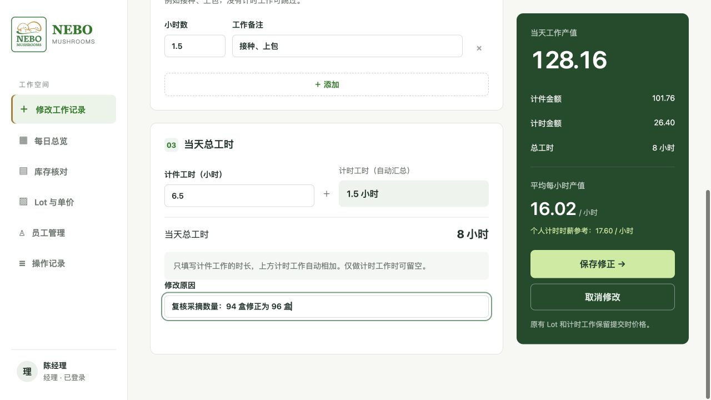

## 五、经理查看日报与导出

进入“每日总览”，选择日期。上方显示当天提交份数、工作总金额、总工时和平均每小时产值；下方逐人列出数量、金额与库存核对状态。“明细”查看项目，“修正”修改该员工记录。

点击右上角“导出 CSV”，下载当前日期的日报，用 Excel 等表格软件打开。导出包含日期、员工、计件/计时类型、Lot、产品或备注、数量、单价、明细金额及当日汇总字段。**每条明细都会带上当日汇总字段，做 Excel 合计时不要重复累加同一个员工同一天的总金额或总工时。**

图 08：两份日报合计 **291.55**、总工时 **16 小时**；右上角可选择日期和导出 CSV。此图拍摄于库存盘点前。

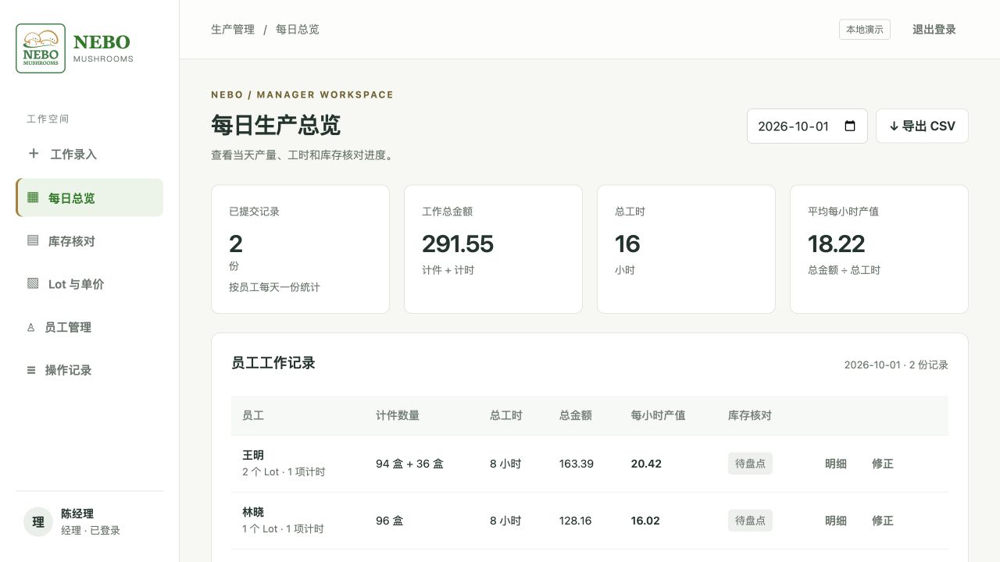

## 六、经理管理员工与时薪

进入“员工管理”查看姓名、登录账号、角色和计时时薪。点击某行“编辑”可修改姓名、时薪或重设密码；重设密码留空时保留原密码，实际重设后原登录会话失效。新时薪不追改已提交的日报。该页面不需要日期筛选，因此右上角不显示日历。

图 09：实际员工管理列表。

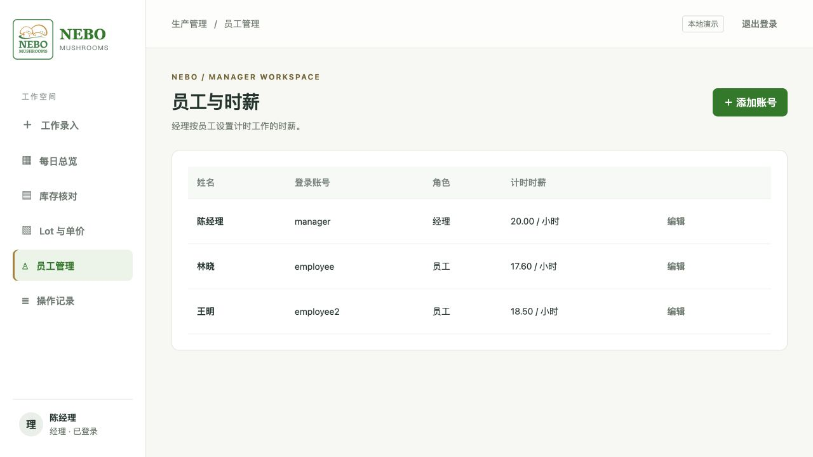

点击“＋ 添加账号”，填写姓名、登录名、初始密码、计时时薪和角色，点击“保存”。密码长度为 10–200 个字符。普通员工只处理自己的记录；经理可使用管理功能。

图 10：新增账号的真实表单，截图未创建额外账号。

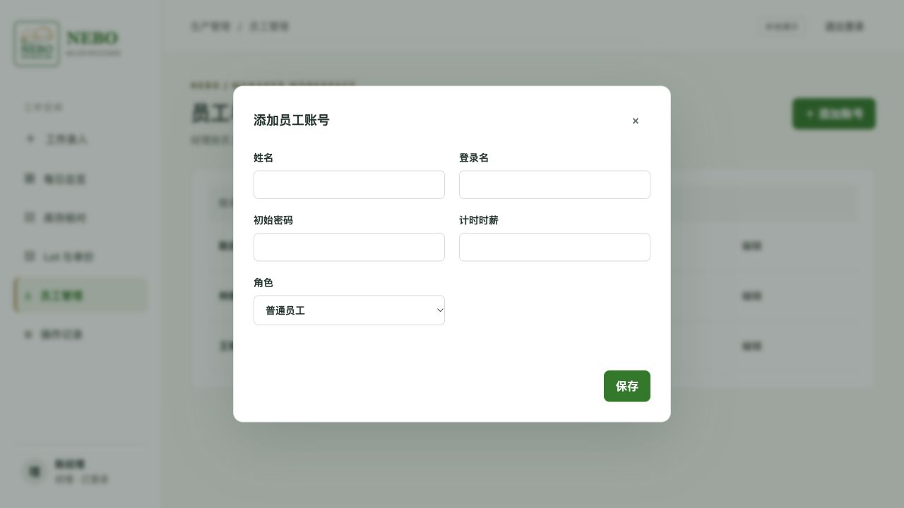

## 七、经理管理 Lot、单价及起始库存

### 1. 查看、调整单价或删除 Lot

进入“Lot 与单价”，可以查看产品、每盒蘑菇数量、当前单价、起始库存和启用日期。点击“调整单价”修改后续录入使用的价格，已提交日报保留原来的金额。

点击“删除”后，该 Lot 从管理列表及新日报候选中移除，已提交表单、历史价格和库存流水保留；修正原日报时仍可保留其中原有的 Lot。此功能不等于清空该 Lot 的库存。本页不显示右上角日期筛选。

图 11：Lot 列表中的单价调整与删除入口。

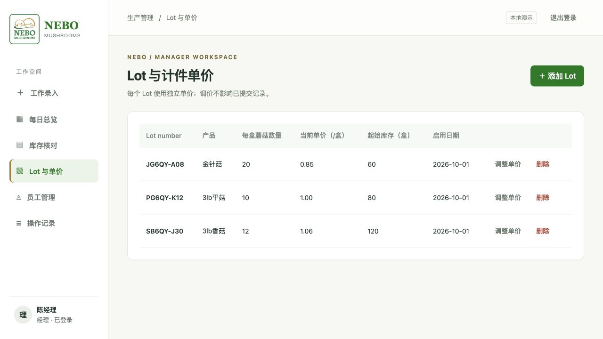

### 2. 添加新 Lot

点击“＋ 添加 Lot”，填写下列内容后保存：

| 字段 | 填写方式 |
| --- | --- |
| Lot number | 唯一批次编号，不与已有编号重复 |
| 产品 | 产品名称，例如 `3lb香菇` |
| 每盒蘑菇数量 | 每盒包含多少蘑菇，填写正整数 |
| 单价（/盒） | 员工每完成一盒对应的计件单价 |
| 起始库存（盒） | 启用日开工前已有的账面盒数，允许 0 |
| 启用日期 | 该 Lot 开始使用的日期；当天即可选择 |

新 Lot 以盒为计量单位。现有旧 Lot 未记录的每盒数量显示“未设置”。起始库存建立后，目前不能在页面中直接修改。

图 12：新增 Lot 表单，产品提示为“3lb香菇”，每盒数量标签已去掉“个/盒”。

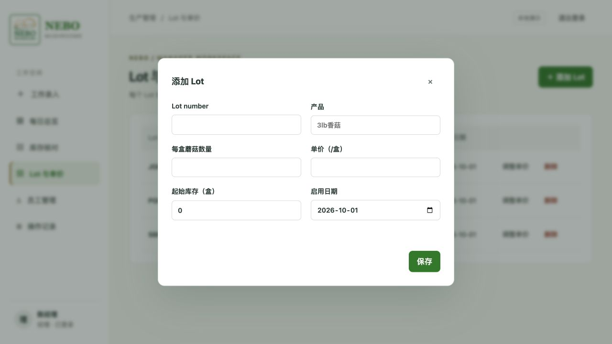

## 八、出库与库存核对

### 1. 登记当天出库

进入“库存核对”，先选择业务日期，再点击“＋ 记录出库”。选择 Lot，填写出库数量及说明，保存后系统自动从账面库存扣减。当前由经理执行出库和盘点。

本例登记香菇批次出库 **50 盒**。误录时，可在页面下方“今日出库记录”点击“撤销”，填写原因后保存，再重新登记正确内容；系统保留撤销操作记录。

图 13：实际填写的出库表单。

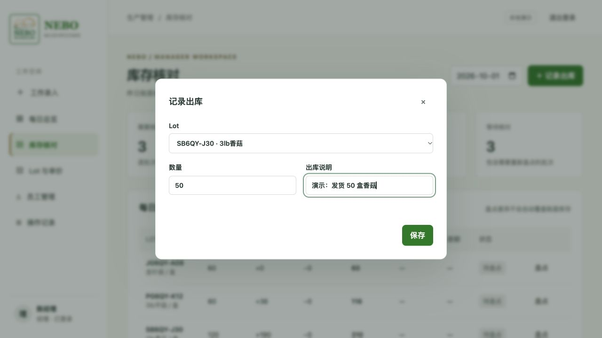

### 2. 输入实际盘点数量

在相应 Lot 行点击“盘点”，填写实际清点的盒数并保存。系统按 **昨日账面结存 + 今日入库 − 今日出库 = 今日应有库存** 计算；启用日以起始库存作为期初数量。

本例香菇：起始 **120** 盒 + 王明 **94** 盒 + 林晓修正后 **96** 盒 − 出库 **50** 盒 = 应有 **260** 盒。实际清点为 260 盒，因此通过核对。盘点应填写真实清点结果，而不是为了通过核对照填账面数量。

图 14：香菇批次的盘点表单。

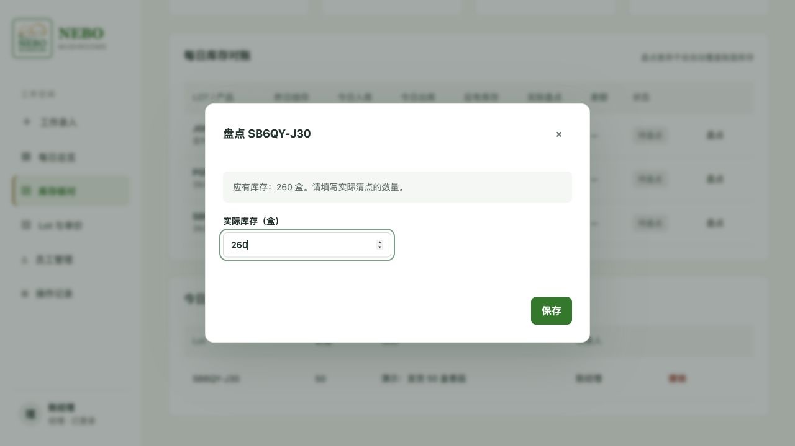

### 3. 根据状态复查

| 状态 | 含义与下一步 |
| --- | --- |
| 待盘点 | 尚未记录有效实盘数量，需安排清点 |
| 核对通过 | 实盘与账面一致 |
| 数量有差异 | 复查员工入库、出库记录及实际清点结果 |
| 需重新核对 | 已盘点后相关数据有变化，需要再次确认并保存盘点 |
| 无需盘点 | 只有计时工作的日报，不涉及计件入库 |

下图香菇 **260 对 260，差额 0**，显示“核对通过”；平菇账面 **116** 盒，实盘 **114** 盒，显示差额 **−2** 和“数量有差异”；金针菇仍待盘点。差异不会自动改写账面库存，也不会自动判定是哪位员工出错。

图 15：同一页面显示通过、差异与待盘点三种结果。

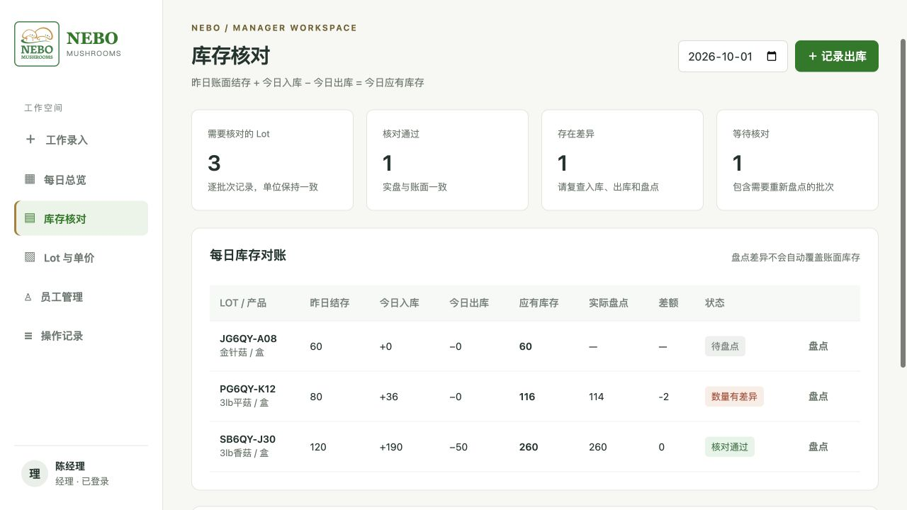

## 九、追溯操作与修改前后内容

进入“操作记录”，查看最近 100 次操作的时间、操作人、操作内容和对象。该页面不按业务日期筛选，也不显示右上角日历。点击对应行“查看变更”可展开细节。

图 16：真实操作列表，包含员工提交、员工修正、经理出库及盘点。

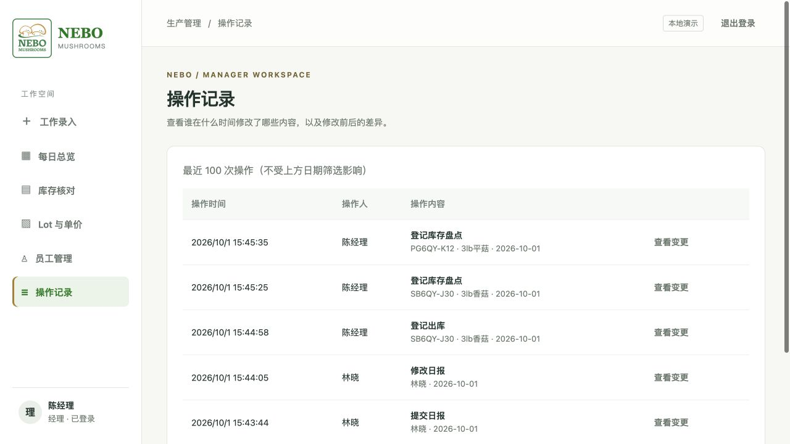

在“操作详情”中，经理可以看到谁在什么时间修改了什么、修改原因以及“原来 / 现在”的对照。下图记录了林晓将 **94 盒改为 96 盒**，同时显示总金额和每小时产值的变化。密码不会以明文出现在操作详情中；旧操作缺失的原值会显示“未记录”。

图 17：数量与金额修正的实际对照。

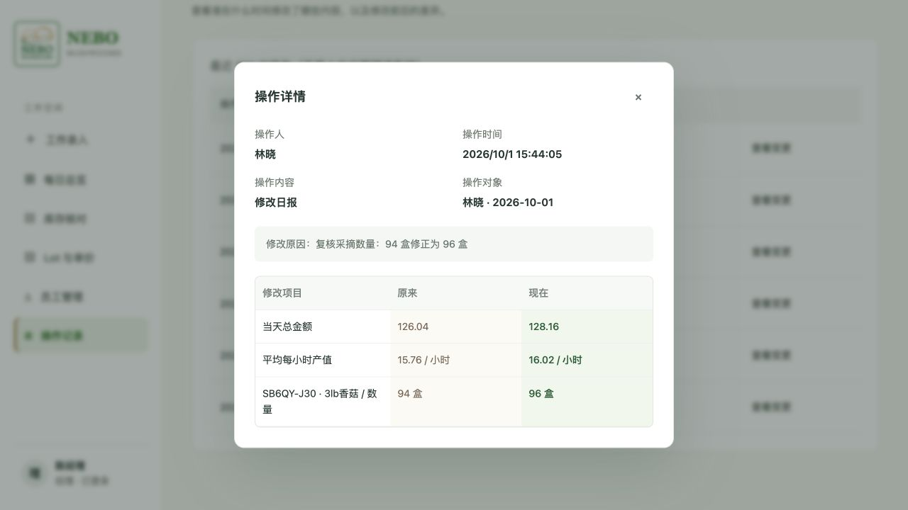

## 十、演示启动与使用范围

### 在当前电脑打开本次演示

本次截图使用独立的演示数据文件，不覆盖原来的演示数据。在项目目录运行以下命令；若服务已经运行，直接打开页面即可，无需重复启动。

```sh
python3 -m harvest.server --demo --db data/presentation-demo.sqlite3 --port 8766
```

浏览器打开 **http://127.0.0.1:8766**，使用上面的演示账号登录。截图样本日期为 **2026-10-01**，后续演示时请切换到这个日期查看同一批日报与盘点。新建的演示数据库只生成基础样本；本说明中的提交、修正、出库和盘点是之后按步骤完成的操作。

需要 Python 3.11 或以上，无第三方运行依赖。`127.0.0.1` 仅用于运行服务的这台电脑，不能作为发给老板的远程访问链接。手机实际访问需要自行配置可访问地址；本文手机图片用于说明当前响应式界面。

### 当前版本边界

- 支持在线录入，尚不支持离线提交；刷新页面不会保留未提交表单。
- 数量按整数盒输入，小时输入步长为 0.05（3 分钟），当天总工时大于 0 且不超过 24 小时。
- 库存按 Lot 核对，暂不做盒/箱换算、损耗、退货或库存调整。
- 目前提供单日 CSV 导出，尚无日期区间报表、审批、封账或自动通知。
- 当前为本地演示；正式部署、域名、备份及实际手机验证由项目负责人安排。

开发和运行细节见 [技术说明](TECHNICAL-README.md)，部署与备份见 [自行部署说明](DEPLOYMENT.md)。分享本说明时请同时保留 `docs/images` 文件夹，或发送随附的图文说明压缩包。
