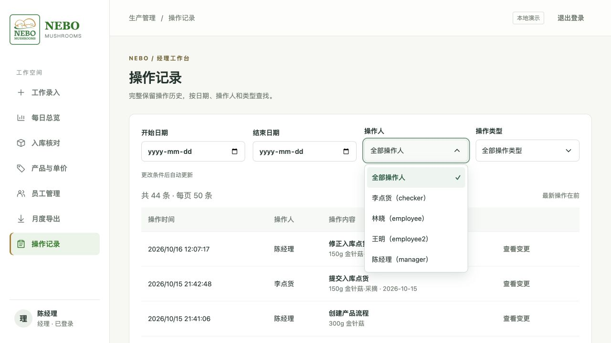
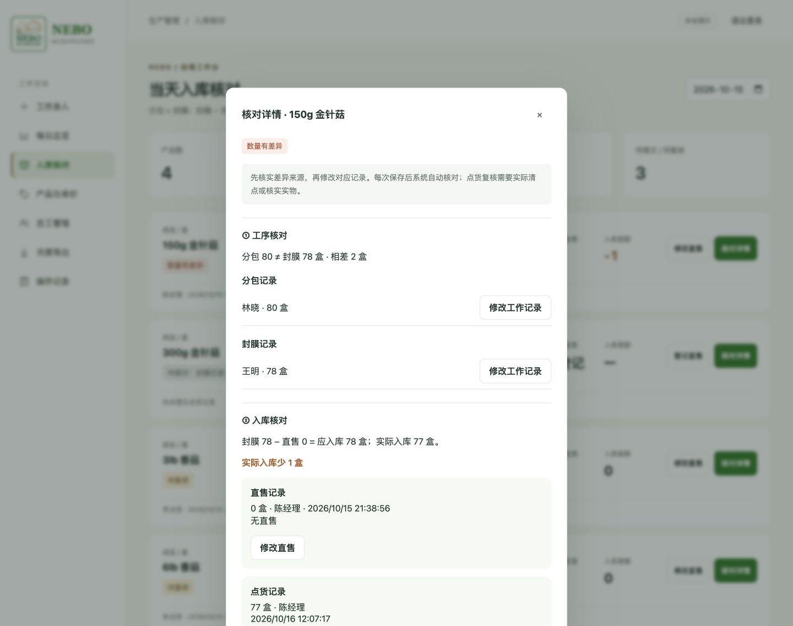
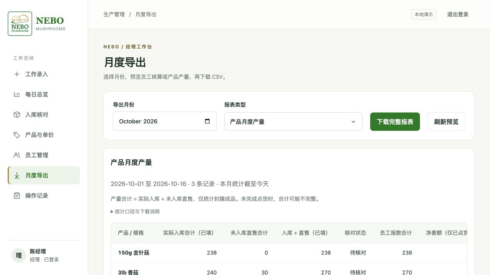
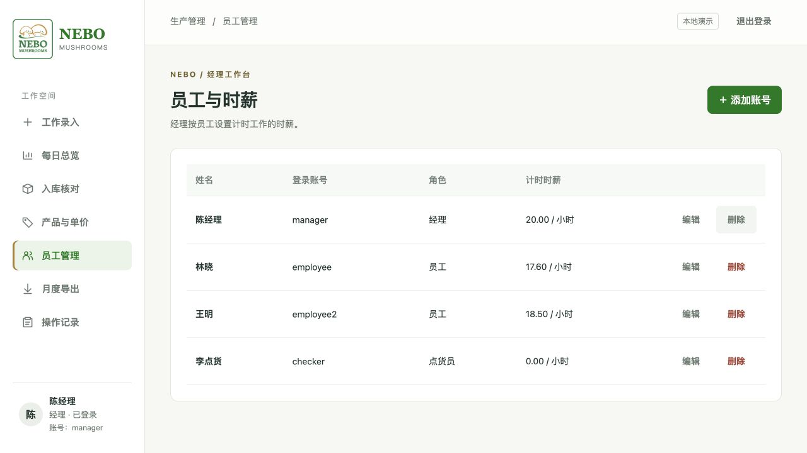
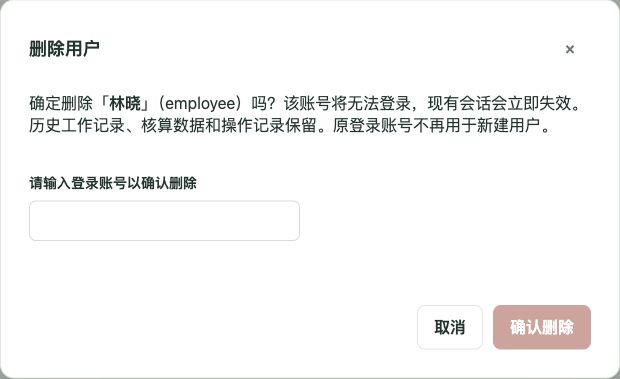

# NEBO Mushrooms 操作说明手册

完整图文使用手册：[下载 PDF](output/pdf/NEBO-使用手册.pdf)（旧版图文参考；本次产品分类与员工兼任点货的变化以本文说明为准）。

当前版本：2026-10-20。以下图片均来自实际运行的应用。系统用于员工计件绩效、计时工作、当天实物点货与月度核算。

## 本次更新：1–3 道自定义工序

「产品与单价」只保留「添加产品」入口。填写成品名称，选择 1、2 或 3 道工序，再按实际顺序逐行填写工序名称、单位与计件单价。名称显示为「成品名称·工序名称」。最后一道自动为成品，前面的均为半成品；所有工序计入绩效，只有成品计入产量。

| 产品 | 按顺序填写工序 |
| --- | --- |
| 150g 香菇 | 采摘 → 分装 → 封膜（成品） |
| 180g / 200g 平菇 | 采摘分装 → 封膜（成品） |
| 3lb mini | 采摘 → 剪根后（成品） |
| 2lb 平菇、3lb 香菇、5lb 平菇 | 一道工序，例如「采摘包装」（成品） |

可选「自动核对工序数量」：选择一道前置工序，与最后一道工序按当天合计 1:1 核对。两道工序必须使用同一单位；例如第二道分装 100 盒、第三道封膜 99 盒会显示差异，不会自动补齐。未开启时不要求工序数量相等，成品仍需独立点货。

新建账号仅提供普通员工和经理；普通员工可选择是否开启点货权限，经理自动拥有点货权限。旧版独立点货员账号在升级启动时转为已开启点货权限的普通员工，账号、密码和历史记录保留，经理可随后关闭权限。

经理在「员工管理 → 编辑员工 → 允许入库点货」选择「开启」并保存。员工刷新页面后，同一账号即可使用「工作录入」「我的记录」「入库核对」，无需第二个账号。撤销权限后不能再提交点货；已保存的历史点货保留。额外点货权限不开放他人的报数、工资或经理管理页面。点货列表来自经理已启用的成品，不要求先有库存；没有可选项目时先检查成品设置和启用日期。

## 1. 添加与编辑产品

- **新建工序**：填写自定义工序名称，例如「采摘分装」「剪根后」，不需要在名称里重复成品名称。
- **选择已有同级工序**：只列出同序号、同成品/半成品类型且启用中的工序。引用沿用原名称、单位和单价，不重复创建工作量。例如 200g 平菇的第一道可以引用 180g 平菇的第一道半成品工序。
- **编辑产品**：复用添加表单，可修改名称、单价及数量核对设置。共用工序默认以引用显示，不能从一个产品里悄悄改动其他产品的工序。需要不同设置时选择新建工序。
- 已有生产记录的工序不允许直接改变单位、顺序或成品类型；可在同一表单选择新建并填写不同名称，替换后的旧工序停用但保留历史。已提交日报保留原名称、单价、类型与工序顺序。
- 新的数量核对设置从修改当天生效，以前日期保留原关联规则。
- 产品选择与工作明细按填写的工序顺序排序，不按工序名称的字序排列。

保存时整体校验，任何一项无效都不会留下半个流程。引用最终成品工序表示共用同一个成品项目，不会新增一份产量；不同规格通常应新建各自的最终工序。

「停用工序」需输入完整项目名称确认。有启用中的后续工序时，先停用后续工序。页面底部可展开已停用项目，历史日报与核算保留。旧版截图及 PDF 仅供参考，本次表单以文字说明为准。

## 2. 员工：每天记录自己的工作

进入「工作录入」，选择日期，添加当天完成的工序和数量。所选成品和半成品均可计件，各自使用对应单位及单价，同一工序不能重复选择。

需要计时的工作另填时长和备注。当天总工时 = 手填的计件工时 + 自动汇总的计时工时。系统显示计件金额、计时金额、总产值和平均每小时产值。

提交后可在自己的记录中点击「修正」，填写原因后保存。修改时入口显示修改工作，保存或取消后恢复。经理也可代为修正，操作记录保存操作人、时间与前后变化。

### 查询操作历史

经理打开「操作记录」，可按开始日期、结束日期、操作人和操作类型筛选，修改任意条件后自动更新结果。日期指操作发生日期，不是所修改日报的工作日期；留空表示不限。日期范围按浏览器本地时区计算，包含结束日期当天。

数据库完整保留操作记录，页面每页显示50条，使用「上一页」「下一页」查看更早的历史。翻页期间固定查询范围，避免新记录插入造成重复；更改筛选条件即可重新获取记录；有筛选条件时可点击「清除筛选」恢复全部记录。「查看变更」展示操作人、修改原因与修改前后内容。普通员工和点货员无权访问全员操作历史。



开启数量核对的工序按同一天报数比较；未关联工序可按实际工作日期报工。旧版封膜项目仍保留每天同一人登记的规则。系统不使用筐到盒的固定换算。

## 3. 点货员：只清点成品

点货员及获授权员工看到所有启用的成品（包括单工序成品和封膜成品），名称不带工序后缀。填写当天累计实际入库数量，不填冷库剩余库存，也不包含未入库就售出的部分。采摘、分包仍计算员工绩效，但不再单独点货。

没有入库请填 0；未填写与 0 不同。已有记录通过「修改点货数量」修正。员工报数变化后，实际复点且数量未变，可点击「已复点，数量不变」并填写复核说明。点货员仍看不到员工报数和产值，保持独立清点。

## 4. 经理：成品联合核对与核对详情

成品需同时满足：

1. 开启自动核对时，**所选前置工序数量 = 最后一道工序数量**。
2. **成品生产报数 − 当天未入库直售 = 点货数量**。未关联的单工序成品只执行这一步核对。

例如分包 100 盒、封膜 100 盒、直售 10 盒、点货 90 盒，应核对通过。若分包 80、封膜 78，即使点货也是 78、入库差额为 0，整体仍有差异。

列表保留「登记直售／修改直售」和「核对详情」。点击「核对详情」可查看分包、封膜、直售、点货的来源和两步核对结果，并进入对应记录修改。保存后系统自动核对，不会自动改数。无直售也需登记 0；未登记会提示待提交。数量差异和待复核可同时显示，复点确认不会消除仍然存在的差异。



分包或封膜报数变化后，原点货需要重新确认。共用分包/封膜仍按关联组合计，各工序只计一次；每个成品分别核对自己的入库和直售。采摘记录不再因未点货显示待核对。

旧点货没有保存分包核对依据，升级后关联成品需要按新规则重新确认；原点货数量保留。

## 5. 月度导出

点击月份右侧日历选择月份，允许浏览器显示英文月份，例如 October 2026。选择报表类型后，预览完整表格并下载 CSV，不再提供精简表格切换。内容保持单行，宽度不足时在表格内左右滑动。

员工月报包含成品、半成品计件与计时绩效、工时等数据。产品月报只计成品实际入库及未入库直售，成品名称不带「·封膜」。采摘和分包不重复计入产量。核对状态现在同时反映分包/封膜匹配与成品入库核对结果。



## 6. 账号管理与删除

经理在「员工管理」添加账号、编辑姓名与时薪、重设密码。每行的「编辑 / 删除」保持单行。当前登录账号的「删除」灰色禁用，不能删除自己，必须由另一位经理操作；普通员工和点货员没有删除权限。

删除其他账号时，需要输入目标的完整**登录账号**确认，不是姓名。删除后该账号从员工列表移除，不能登录，已有会话失效；历史日报、点货、直售、月度核算与操作记录仍保留。经理可修正已有日报，但不能给已删除账号新增日报。当前没有恢复入口，原登录名也不能重新注册，请核对对象后再确认。





## 7. 手机身份与主屏幕入口

手机顶部仅显示圆形头像，使用姓名首字，例如「陈经理」显示「陈」。完整姓名可结合工作记录核对。

使用正式网址时，可在 iPhone Safari 分享菜单或 Android Chrome 菜单中选择「添加到主屏幕」；实际入口由手机浏览器决定。快捷入口使用 NEBO 品牌图标。若旧快捷方式仍显示旧图标，可重新添加。主屏幕入口仍需联网和登录，不提供离线填报。

## 8. 演示数据与启动


当前演示库使用 `data/fresh-demo.sqlite3`。包含 3lb 香菇、6lb 香菇、150g 金针菇完整流程和最近三天的工作、点货与直售；实际界面测试还创建了引用采摘的 300g 金针菇流程。示例覆盖核对通过、差异和待点货。示例均非真实业务数据。

```sh
python3 -m harvest.server --demo --db data/fresh-demo.sqlite3 --port 8768
```

浏览器打开 <http://127.0.0.1:8768>。

| 角色 | 登录账号 | 演示密码 |
| --- | --- | --- |
| 经理 | manager | Harvest2026! |
| 员工 | employee / employee2 | Harvest2026! |
| 员工（已开启点货权限） | checker | Harvest2026! |

重新生成演示时使用一个不存在的文件名，脚本不会覆盖已有数据库：

```sh
python3 scripts/create_demo.py data/new-demo.sqlite3
```

自行部署与维护见 [部署说明](docs/DEPLOYMENT.md)。项目结构与业务规则见 [技术说明](docs/TECHNICAL-README.md)。

测试方法与上线验证范围见 [检查说明](docs/INPUT-QA.md)。
