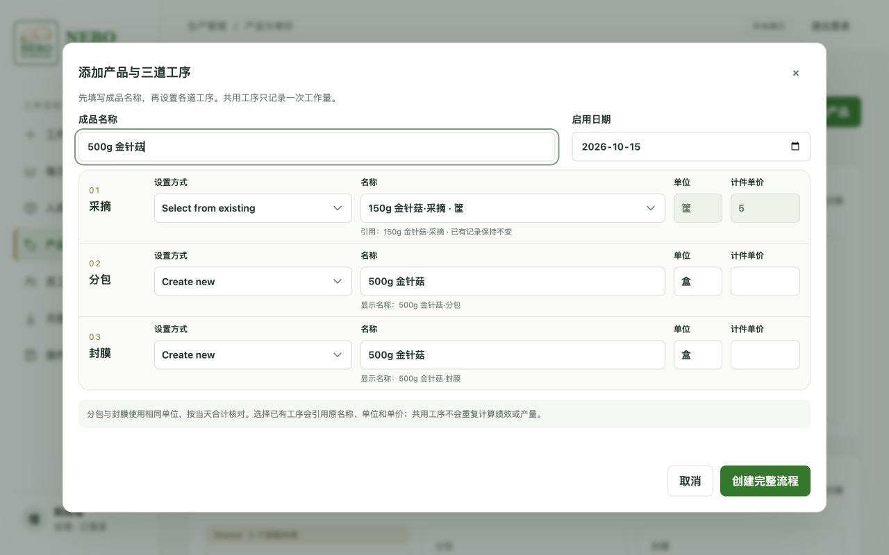
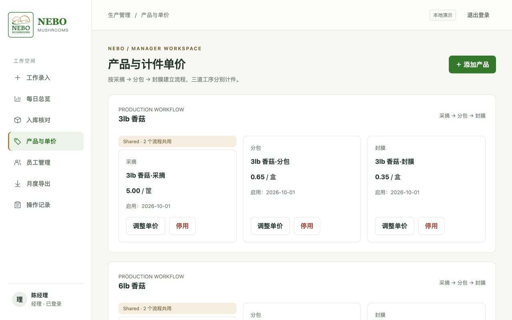

# NEBO Mushrooms 操作说明手册

当前版本：2026-10-16。以下图片均来自实际运行的应用。系统用于员工计件绩效、计时工作、当天实物点货与月度核算。

## 1. 添加产品：一次设置完整流程

经理进入「产品与单价」，点击「添加产品」，先输入成品名称和启用日期，再按三行设置 **采摘 → 分包 → 封膜**。每行都有名称、单位和计件单价。

- **新建工序**：名称默认跟随成品名称，可单独修改；系统添加工序后缀，例如「金针菇·封膜」。采摘默认按筐，分包和封膜默认按盒。
- **选择已有工序**：只显示同级且启用中的项目。选中后引用原名称、单位和单价，不能在这个表单里修改它们。
- 分包与封膜的单位必须一致；填写完后一次保存三道工序。任何一项无效都不会留下不完整产品。



多个规格可以共用一个采摘项目。例如 3lb 和 6lb 香菇来自同一批筐，创建第二个规格时选择已有采摘，分包和封膜分别新建。每个工序都支持引用已有项目；**引用已有封膜表示同一个最终成品项目，不会新增一份产量**。不同成品规格通常应新建各自的封膜项目。

保存后按产品流程分组。共用项目标注“共用”，工作录入和点货列表只出现一次；调整其单价会影响以后所有引用它的流程，已提交记录保留原单价。



点击「停用」需输入完整项目名称确认。有启用中的后续工序时，先停用后续工序；共用项目需检查所有相关流程。页面底部可展开已停用项目，历史日报与核算仍保留。

## 2. 员工：每天记录自己的工作

进入「工作录入」，选择日期，添加当天完成的工序和数量。三道工序全部计件，各自使用对应单位及单价，同一工序不能重复选择。

需要计时的工作另填时长和备注。当天总工时 = 手填的计件工时 + 自动汇总的计时工时。系统显示计件金额、计时金额、总产值和平均每小时产值。

提交后可在自己的记录中点击「修正」，填写原因后保存。修改时入口显示修改工作，保存或取消后恢复。经理也可代为修正，操作记录保存操作人、时间与前后变化。

采摘可在前一天完成；分包与封膜必须同一天完成。当天所有封膜项目只能由同一位员工登记。系统比较数量，不使用筐到盒的固定换算。

## 3. 点货员：只清点成品

点货员只看到完成封膜的成品，名称不带工序后缀。填写当天累计实际入库数量，不填冷库剩余库存，也不包含未入库就售出的部分。采摘、分包仍计算员工绩效，但不再单独点货。

没有入库请填 0；未填写与 0 不同。已有记录通过「修改点货数量」修正。员工报数变化后，实际复点且数量未变，可点击「已复点，数量不变」并填写复核说明。点货员仍看不到员工报数和产值，保持独立清点。

## 4. 经理：成品联合核对与核对详情

成品需同时满足：

1. **完成分包 = 完成封膜**。
2. **完成封膜 − 当天未入库直售 = 点货数量**。

例如分包 100 盒、封膜 100 盒、直售 10 盒、点货 90 盒，应核对通过。若分包 80、封膜 78，即使点货也是 78、入库差额为 0，整体仍有差异。

列表保留「登记直售／修改直售」和「核对详情」。点击「核对详情」可查看分包、封膜、直售、点货的来源和两步核对结果，并进入对应记录修改。保存后系统自动核对，不会自动改数。无直售也需登记 0；未登记会提示待提交。数量差异和待复核可同时显示，复点确认不会消除仍然存在的差异。


分包或封膜报数变化后，原点货需要重新确认。共用分包/封膜仍按关联组合计，各工序只计一次；每个成品分别核对自己的入库和直售。采摘记录不再因未点货显示待核对。

旧点货没有保存分包核对依据，升级后关联成品需要按新规则重新确认；原点货数量保留。

## 5. 月度导出

点击月份右侧日历选择月份，允许浏览器显示英文月份，例如 October 2026。选择报表类型后，预览完整表格并下载 CSV，不再提供精简表格切换。内容保持单行，宽度不足时在表格内左右滑动。

员工月报包含三道工序与计时绩效、工时等数据。产品月报只计成品实际入库及未入库直售，成品名称不带「·封膜」。采摘和分包不重复计入产量。核对状态现在同时反映分包/封膜匹配与成品入库核对结果。


## 6. 演示数据与启动

旧演示已备份，当前演示库使用 `data/fresh-demo.sqlite3`。包含 3lb 香菇、6lb 香菇、150g 金针菇完整流程和最近三天的工作、点货与直售；实际界面测试还创建了引用采摘的 300g 金针菇流程。示例覆盖核对通过、差异和待点货。示例均非真实业务数据。

```sh
python3 -m harvest.server --demo --db data/fresh-demo.sqlite3 --port 8768
```

浏览器打开 <http://127.0.0.1:8768>。

| 角色 | 登录账号 | 演示密码 |
| --- | --- | --- |
| 经理 | manager | Harvest2026! |
| 员工 | employee / employee2 | Harvest2026! |
| 点货员 | checker | Harvest2026! |

重新生成演示时使用一个不存在的文件名，脚本不会覆盖已有数据库：

```sh
python3 scripts/create_demo.py data/new-demo.sqlite3
```

本次验证：41 项 Python 测试通过，JavaScript 语法与操作日志显示测试通过；实际浏览器验证创建并引用已有工序、手机点货保存、CSV 下载，以及 1280px 桌面和 390px 手机布局。CSV 11 列、2 条员工记录的结构检查通过。

部署与迁移详见 [技术说明](docs/INCOMING-V2.md)。旧版截图和已废止的操作步骤仅存档于 [历史手册](docs/ARCHIVED-MANUAL.md)，不作为当前操作指南。

输入边界与手机回归检查：见 [检查记录](docs/INPUT-QA.md)（44 项 Python 测试通过）。
