# NEBO Mushrooms 操作说明手册

## 当前操作：按三道工序创建产品（2026-10-15）

“产品与计件单价”现在直接管理工序，不再有独立的“分装与封膜关联”模块，也不需要选择成品／半成品类型。

1. 添加产品，选择 **采摘**，填写蘑菇名称与规格（如金针菇150克）、单位（默认筐）、单价和启用日期。
2. 再次添加，选择 **分包**，必须选择上一道采摘项目。名称自动继承，默认按盒计件，可填写分包单价。
3. 再次添加，选择 **封膜**，必须选择上一道分包项目。名称与单位自动继承，填写封膜单价，保存即完成关联并开启当天数量核对。

每条流程按同一规格建立一对一的三道工序，不同规格请从采摘开始建立独立流程。上道项目须启用，且没有后续项目；启用日期不能早于上道工序。名称显示为“金针菇150克·采摘 / ·分包 / ·封膜”，三项分组显示，手机上纵向排列。

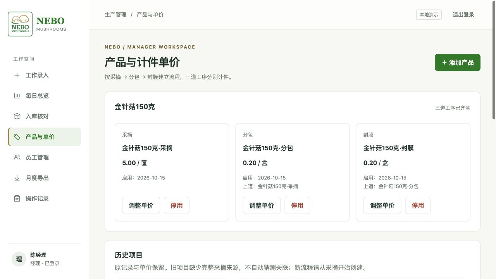

添加分包时必须选择采摘，不能跳过关联；表单会自动显示继承的名称。下图是本地实际创建平菇演示流程时的表单。

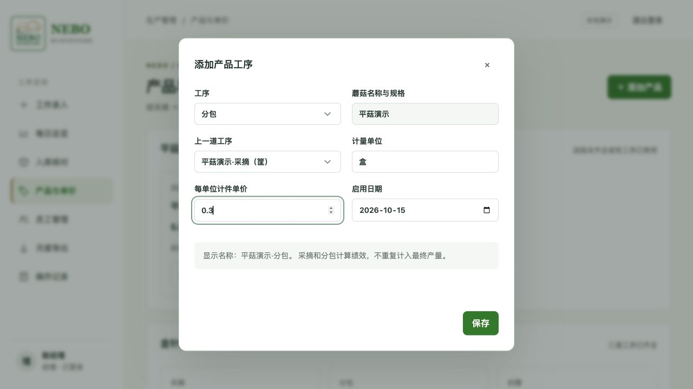

三道工序都算绩效。采摘到分包允许跨天；分包必须当天立即封膜，当天全部封膜由一人登记。多人分包合计与该员工封膜数量按1:1核对；筐和盒不做固定换算。新流程月度产量只计封膜对应的实点入库及未入库直售，不把采摘与分包再加一遍。员工月报的新工作量按工序和单位分列。

点击“停用”后弹窗要求输入完整项目名称，完全一致才可确认。若有启用中的后续工序，需先停用后续工序（封膜→分包→采摘），避免留下断开的流程。停用只阻止新录入，已提交日报、单价和核对历史保留。页面底部展开“已停用项目”可查看这些记录。

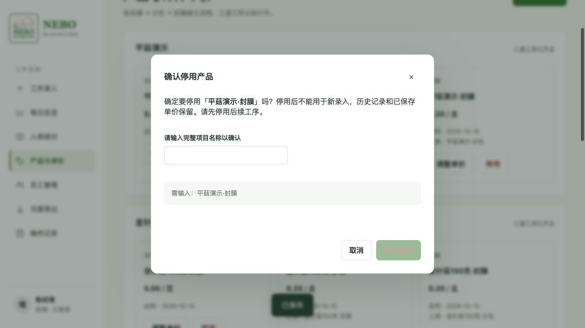

旧记录没有完整的采摘来源，显示在“历史项目”区域；仅根据原有分包与封膜关联补充已知工序，不猜测采摘关系、不重算历史金额。旧日报及旧报表统计口径保留；新流程从采摘重新建立。

演示地址：<http://127.0.0.1:8768>，演示库为 `data/workflow-demo.sqlite3`。包含金针菇150克完整流程，以及已停用的平菇演示流程。

```sh
python3 -m harvest.server --demo --db data/workflow-demo.sqlite3 --port 8768
```

本次验证：36项Python测试、JavaScript语法及操作日志显示测试通过；实际浏览器验证三步创建、名称继承、停用确认与停用列表，390px手机页面无横向溢出。

以下为前几版操作示例和截图，涉及独立关联模块及手选产品类型的步骤，以本节的新流程为准。

## 新增：当天分装与封膜核对

现在的三道工序是：**采摘大筐（半成品、筐）→ 分装小盒（半成品、盒）→ 封膜（成品、盒）**。三道工序都计员工绩效，只有最终成品计入月产量。下文较早的两阶段截图保留历史演示数据；未封膜小盒现在应建立为半成品，不能沿用旧的成品项目。

经理在“产品与单价”分别创建分装、封膜项目，再点击“关联工序”，选择同一规格、相同单位的两个项目及启用日期。关联为一对一，保存后固定，不需要员工填写批次或选择上一道工序的员工。采摘筐与小盒不关联，也不使用10%容差判断分装和封膜。

在“入库核对”查看“当天分装 → 封膜核对”。下图是实际演示：林晓分装60盒、王明分装40盒，王明封膜100盒，显示工序匹配。展开明细即可查看两边每个人的报数。

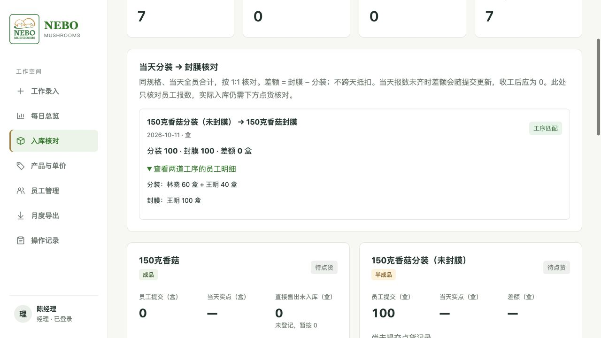

按用户确认的规则，分装后必须立即封膜，且当天所有封膜项目由同一人完成；只有采摘到分装允许跨天。**差额 = 当天封膜合计 − 当天分装合计**。只有一边报数时也显示差异，双方都没报数时显示“尚无报数”。当天未报齐时可以继续提交，收工后再检查差额是否归零。修正日报后，重新进入页面会按最新报数计算；昨天或明天的数量不会抵扣今天的差额。

系统会拒绝另一位员工在同一天提交封膜项目（包括经理代填），原封膜人仍可修正数量。若误记了负责人，先从原日报移除封膜项目，再由正确员工登记。每天可以安排不同封膜人，但同一天只能有一人。该校验用于已建立工序关联的封膜项目。系统核对每日数量，不能仅凭日报证明实际操作是否紧接着分装完成。

这项核对独立于实物点货：100盒分装对应100盒封膜，只说明工序报数一致；封膜后的实际入库仍需点货员独立填写。工序差异不直接扣绩效、不阻止如实提交，也不改写入库数字。现有月报的“待核对日报数”和“核对状态”仍指实物点货；工序差异在每日此区域单独检查。

手机端同样展示合计、差额及员工明细，不需要横向滑动。

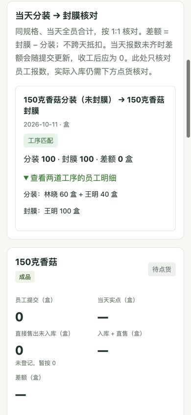

最新演示地址：<http://127.0.0.1:8768>，选择2026-10-11查看上述数据。启动命令：

```sh
python3 -m harvest.server --demo --db data/process-demo.sqlite3 --port 8768
```

## 1. 先了解操作逻辑

每天的流程是：

1. **员工报数**：选择产品规格，填写完成数量（盒或筐等）、计时工作和计件工时，提交当天记录。
2. **点货员实点**：独立清点当天新入库的产品，逐项按对应单位填写当天累计完成数量。
3. **经理登记直售并核对**：独立登记当天直接售出、未入库的盒数，再按日期和产品，对照员工提交与“实际入库 + 未入库直售”。
4. **发现差异后复查**：核实员工报数及实物点货；相关人员修正记录，再重新确认点货。

| 角色 | 主要入口 | 可以做什么 |
| --- | --- | --- |
| 员工 | 工作录入、我的记录 | 提交每日成品、半成品数量和工时；查看产值；修正自己的日报 |
| 点货员 | 入库核对 | 填写、修正或重新确认当天实际完成数量；查看点货人和时间 |
| 老板 / 经理 | 每日总览、入库核对、产品与单价、员工管理、操作记录 | 查看全部日报、差额与员工明细；修正记录；导出；维护账号和产品 |

点货员页面不显示员工报数、差额、单价、时薪或产值，便于独立点货。员工只能查看和修正自己的日报。

### 半成品隔天加工：分别计绩效，成品只统计一次

经理先建立两个项目：**香菇采摘 / 半成品 / 筐 **，以及 **150克香菇 / 成品 / 盒 **。员工只需选自己当天做的项目，不需要填写关联批次或换算比例。

| 日期 | 员工报数 | 点货员独立实点 | 员工绩效 | 成品月产量 |
| --- | --- | --- | --- | --- |
| 10月8日 | 林晓采摘10筐 | 半成品10筐 | 林晓50.00 | 不计入 |
| 10月9日 | 王明分装150盒 | 成品150盒 | 王明75.00 | 150盒 |

两天可以是不同员工，跨月也一样：绩效计入各自实际工作的月份，成品产量计入成品完成的月份。**不把150盒从10筐里扣除，也不设置固定转换率。** 当前系统记录每天工作和点货，不跟踪半成品剩余库存、耗用或损耗；约10%波动不作为自动报警阈值。

下图的产品管理中，半成品与成品有明确分类和独立单价。

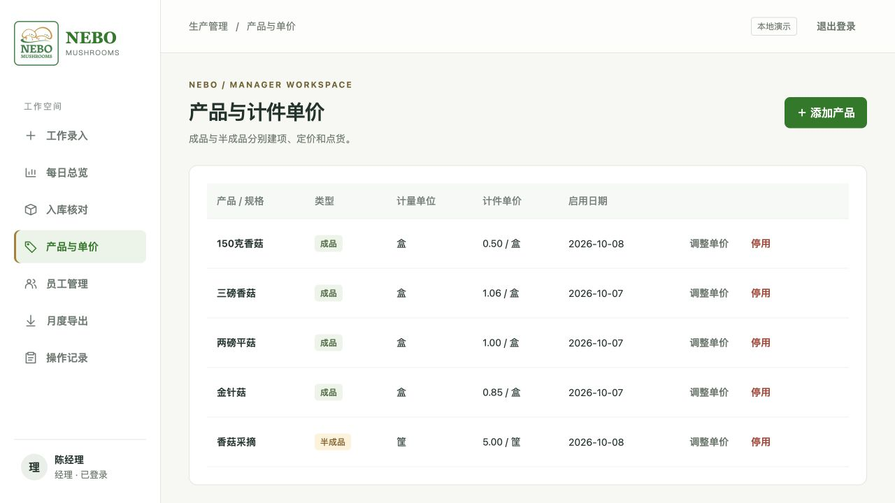

## 2. 登录系统

打开公司提供的系统地址，输入自己的账号、密码，点击 **“登录工作台 →”**。三种角色共用这个登录页，系统根据账号自动显示相应功能；点货员登录后直接进入入库点货。

下图为当前登录页。“本地演示”账号提示只用于演示环境。

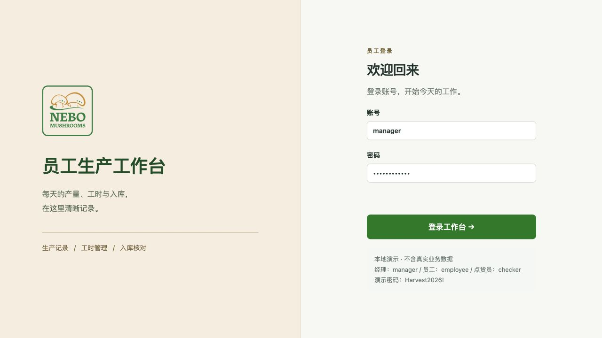

## 3. 员工：填写当天工作

### 3.1 确认日期，选择计件项目和数量

进入 **“工作录入”**，先确认日期。计件工作不默认生成空行，需要时点击 **“＋ 添加”**，选择今天完成的产品规格，再按显示的单位填写数量。

例如：两磅平菇 `5` 盒、三磅香菇 `10` 盒。员工不需要输入 Lot number；同一产品选过后，不会再出现在其他新行的可选列表中，避免重复填报。选错项目可点击该行的 **“×”** 移除。

产品名称由经理维护，请按完整规格选择。成品按盒、半成品按筐等经理设定的单位填写。选项同时标出类型与单位，单价也按对应单位显示。下图展示手机端实际产品下拉菜单。

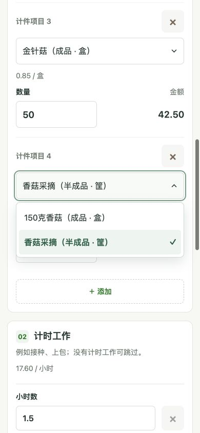

### 3.2 填写计时工作和当天工时

有接种、上包等计时工作时，在 **“计时工作”** 点击 **“＋ 添加”**，填写小时数和工作备注。没有计时工作可以跳过；有多项时可分别添加，系统自动汇总时长。

在 **“当天总工时”** 中，只手动填写 **计件工时**。右侧的计时工时来自上方项目自动相加，不要把计时工时再次填入左侧。

| 输入内容 | 示例 |
| --- | --- |
| 计时工作 | 接种、上包，1.5 小时 |
| 手动填写计件工时 | 6.5 小时 |
| 系统计算当天总工时 | 6.5 + 1.5 = 8 小时 |

仅做计时工作时，计件工时可以留空。下图是已有日报进入修正后的实际表单，工时填写方式与首次录入相同。

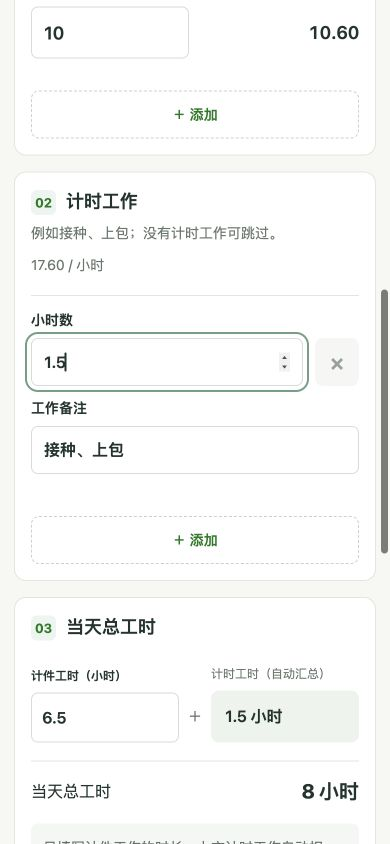

### 3.3 检查金额，再提交

向下查看汇总区，确认产品、盒数、工时无误后，首次录入点击 **“提交今日记录 →”**。每位员工每天提交一份记录；已提交后通过“修正”更新，不用重复新建。

计算方式如下，示例使用林晓的记录：

| 指标 | 计算方式 | 示例结果 |
| --- | --- | --- |
| 计件金额 | 各产品盒数 × 对应每盒单价，再相加 | 5 × 1.00 + 10 × 1.06 = 15.60 |
| 计时金额 | 计时小时合计 × 个人计时时薪 | 1.5 × 17.60 = 26.40 |
| 当天工作产值 | 计件金额 + 计时金额 | 42.00 |
| 当天总工时 | 计件工时 + 计时工时 | 8 小时 |
| 平均每小时产值 | 当天工作产值 ÷ 当天总工时 | 5.25 / 小时 |

**工作产值用于生产效率参考，不等于工资结算。** 页面中的个人计时时薪用于计时金额计算，平均每小时产值则是当天全部工作计算出的结果。

下图是同一汇总区的**修正模式**，所以按钮显示“保存修正”和“取消修改”；首次录入显示提交按钮。


## 4. 员工：查看和修正记录

### 4.1 查看自己的日报

点击 **“我的记录”**，选择工作日期，查看该日的产品盒数、计时备注、总工时、金额和入库核对状态。手机页面向下滑动可以看到完整明细和 **“修正工作记录”** 按钮。

例如下图中，林晓当天已提交 1 份记录，总金额 42.00，总工时 8 小时。显示“数量有差异”说明涉及的产品需要复查，不能仅凭这个标签判断是该员工填错。

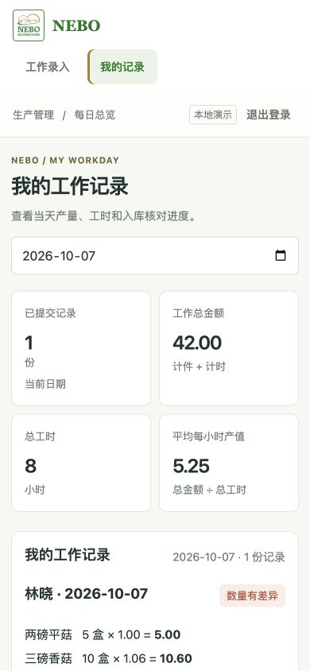

### 4.2 修改填错的内容

点击 **“修正工作记录”** 后，原来的数量、工时和备注会带回表单。导航及页面标题变为 **“修改工作记录”**，帮助确认当前正在修改已有日报。

修改需要调整的项目，填写 **“修改原因”**，检查汇总金额后点击 **“保存修正 →”**。不想保留本次改动时点击 **“取消修改”**。保存或取消后，导航恢复“工作录入”。经理也可以在员工日报中发起修正。

原有产品单价与个人时薪沿用提交时的记录，后续调价不会自动改写历史金额。下图展示实际进入修正后的页面；本次截图后已取消，未改变演示报数。


如果修正改变了已点货产品的数量，该产品会变成 **“需重新核对”**。原实点数仍保留，需要点货员或经理重新确认；只改计时备注不会触发产品数量复核。

## 5. 点货员：记录当天入库

### 5.1 选择日期，逐项清点

点货员登录后进入 **“当天入库点货”**。确认日期，对照实际货物清点每种产品当天完成的总数量，再点击 **“填写数量”**。

这里填写的是**当天生产的累计实际入库数量**，不要把未入库直售加到点货数中，不包括以前的存货，也不减掉当天发出的货。尚未填写显示“待点货”；当天确实没有入库时，应明确填写 `0`。

下图是尚未提交点货时的实际页面。点货员看不到员工提交合计，按自己的实点结果填写即可。

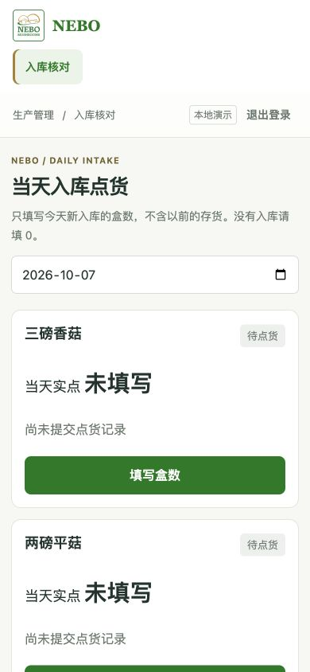

### 5.2 输入当天累计总数并保存

弹窗会显示产品名称和日期。在 **“当天实际入库（盒）”** 输入非负整数，点击 **“保存”**。例如三磅香菇当天共入库 `20` 盒，就填写 `20`。

每个日期、每种产品只有一条点货总数，多名点货员共用这条结果。**保存的是当天总数，不是在原来数字上追加。** 例如上午共 8 盒、下午又入库 12 盒，更新时应填当天总数 `20`，不能只填 `12`。

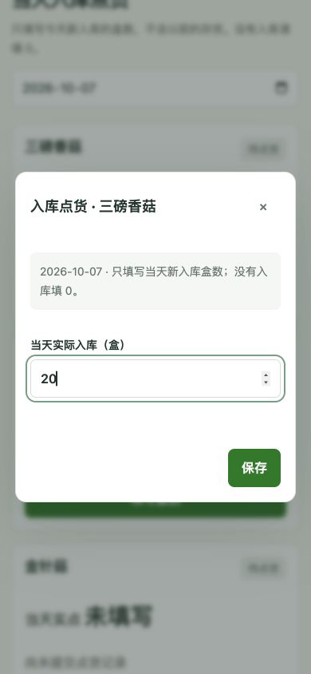

### 5.3 修正或重新确认点货

已经保存的产品会显示实点盒数、点货人和时间。要改正数量或重新复核，点击 **“修正 / 确认点货”**，填写正确的当天总数，以及 **“修改 / 复核原因”**，再保存。

例如重新清点确认原来漏记了一盒，可把 `9` 改为 `10`，原因写“重新清点，补记漏计的1盒”。如果数量仍为 `9`，也可以保留原数，写明复核原因后确认。下图仅展示已保存 9 盒的修正表单，尚未提交修改。


如果打开表单后，其他人已经修改该点货记录，或员工报数发生变化，系统会提示刷新后重新确认，避免旧页面覆盖新结果。

## 6. 老板：核对报数与入库

### 6.1 看每种产品是否一致

进入 **“入库核对”**，选择日期，逐项查看员工提交、实际入库、直接售出未入库、合计与差额。

**差额 = 当天实际入库 + 当天直接售出未入库 − 员工提交合计。** 负数表示合计比报数少，正数表示合计比报数多。未登记直售时暂按 0 计算，并明确显示“未登记，暂按 0”；发现差异应先确认是否漏记直售，不可为了凑平数字填写。

| 演示产品 | 员工提交 | 实际入库 | 未入库直售 | 结果 |
| --- | --- | --- | --- | --- |
| 三磅香菇 | 20 盒 | 20 盒 | 0（未登记） | 核对通过 |
| 两磅平菇 | 10 盒 | 9 盒 | 1 盒 | 合计 10 盒，核对通过 |
| 金针菇 | 0 盒 | 未填写 | 0（未登记） | 待点货 |

下图来自新版独立演示库：10月9日补录10月7日的1盒未入库直售，点货员原来的9盒不变。此前员工记录截图中的“数量有差异”展示补录前的状态；补录后相关日报状态同步更新。

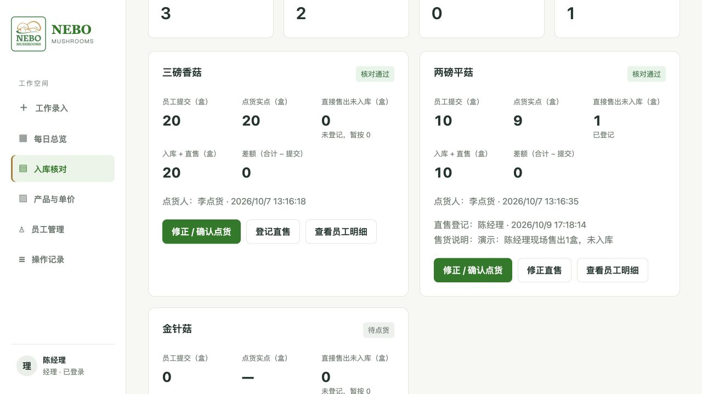

### 登记当天直接售出、未入库的货

采用“售货方单独登记、点货员独立点货”的方式，减少口头交接漏记和重复加数。当前由**经理账号**登记，普通员工和点货员没有直售写入权限；若由经理代录，在售货说明里写明实际售货人及单据号。

1. 在对应产品卡片点击 **“登记直售”**。
2. 输入当天累计直接售出且从未入库的盒数，填写售货说明。
3. 点击保存，系统自动计算“入库 + 直售”与员工提交的差额。
4. 修改时点 **“修正直售”**，填写当天正确总数和修改原因；误记可修正为 0，保留追溯记录。

同一天、同一产品共用一个直售总数，多位经理更新的是总数，不能各自重复追加。系统阻止旧表单覆盖他人已保存的新版本。全部直接卖出、没有实际入库时，点货员仍需明确填写入库 `0`，不能留空。

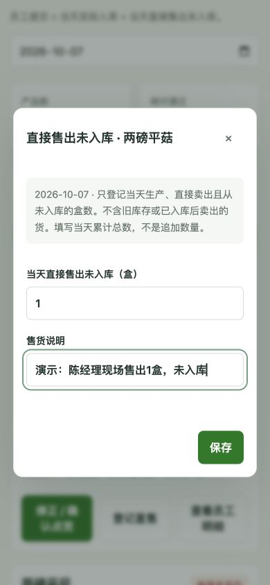

**口径示例：**当天生产100盒，90盒真正入库、10盒未入库直接卖出，则点货填90，直售填10。若这90盒入库后又卖出20盒，累计入库仍是90，不能改填晚上剩余的70，也不能把这20盒再计入“未入库直售”。仅靠晚上剩余数量无法完成当前核对，需按实际入库过程累计记录。

直售不会改变员工产值或点货员已填数字，也不会清除员工报数变化造成的“需重新核对”。无直售记录的旧日期继续按直售0计算，历史点货及金额不变。

### 6.2 查看差异涉及哪些员工

点击产品下的 **“查看员工明细”**，查看每位员工对此产品提交的盒数。下图中，两磅平菇共 10 盒，王明和林晓各提交 5 盒。

发现差额后，先核实产品规格、日期、员工数量、实物点货及未入库直售。系统显示差异，供大家复查，不会自动认定谁填错，也不会自动把员工数量改成实点数量。

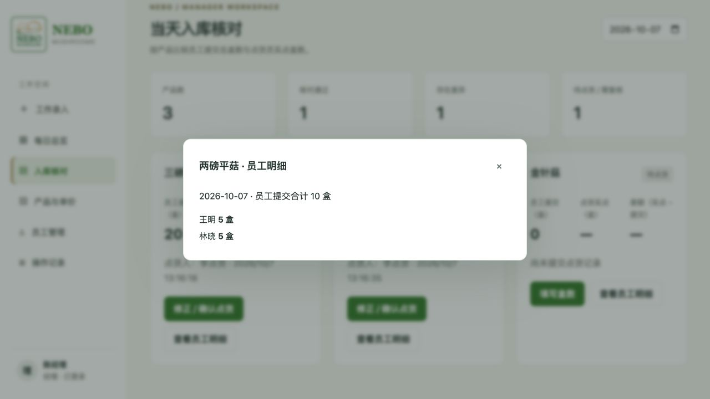

### 6.3 理解核对状态

| 状态 | 含义 | 下一步 |
| --- | --- | --- |
| 待点货 | 该产品当天还没有实际入库数 | 点货员填写；无入库则填 0 |
| 核对通过 | 实际入库加未入库直售与员工合计一致 | 保留记录，继续检查其他产品 |
| 数量有差异 | 实际入库加未入库直售与员工报数不相等 | 复查报数和点货，按实际情况修正 |
| 需重新核对 | 点货后该产品的员工报数发生变化 | 重新核实当天总数，填写原因并确认 |

建议先完成员工报数，再做当天最终点货确认。员工后来补报或修改数量时，需要再次核对。点货员自己的页面使用“已提交”等简化提示；老板页面才展示数量差额。

## 7. 老板：查看产值与月度导出

每日情况继续在 **“每日总览”** 选择日期查看。点击员工的“明细”查看当天项目，点击“修正”修改日报。导出用于月度核算，入口集中在经理专属的 **“月度导出”** 页面。

### 7.1 员工月度核算

点击侧栏 **“月度导出”**，在左侧选择月份和 **“员工月度核算”**。右侧自动展示该月每位员工一行的汇总：

| 字段 | 用途 |
| --- | --- |
| 总产值、总工时 | 月度工资核算的基础数据 |
| 计件产值、计时产值 | 分开查看两种工作的金额 |
| 计件工作时长（小时）、计时工作时长（小时） | 分别为计件工作用时、按小时计价的工作用时；两者相加为总工时 |
| 平均每小时产值 | 月总产值 ÷ 月总工时，不是每日平均数的简单平均 |
| 提交天数、计件工作量（分类） | 已提交日报天数；工作量按成品/半成品及单位分列，例如“成品258盒；半成品22筐” |
| 待核对日报数 | 含待点货、数量有差异或需重新核对产品的日报份数 |

金额按每天已保存的历史单价、时薪汇总，不用现在的单价重算。未提交的日期不推算工时；没有日报的普通员工显示提交0天，提醒经理检查，不表示已核实零出勤。有本人日报的经理也纳入核算，点货员不纳入。

以下为补充10月8日、9日蘑菇演示数据后的实际月报：林晓月产值437.51、总工时24.00；王明月产值435.66、总工时24.00。员工报表已移除登录账号和月份两列，月份保留在选择器与下载文件名中。当前月份尚未结束，预览会显示统计截止日期。产值供工资核算使用，不自动计算加班规则、扣款或其他工资项目。

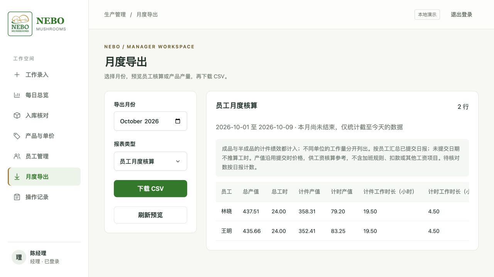

### 7.2 产品月度产量

在同一页面将报表类型切换为 **“产品月度产量”**，只按**成品**规格汇总该月的货物，半成品不会出现在预览或 CSV 中：

- **实际入库合计（已填）**：逐日已填写的实际入库量相加。
- **未入库直售合计**：逐日未入库直售数量相加。
- **入库 + 直售（已填）**：用来查看已记录的生产去向，两类数量分列以免把销售部分误认为真正入库。
- **员工报数合计**：该月员工报出的生产总数，便于交叉检查。
- **待点货、差异、需复核天数**：检查月报是否还缺数据或存在未解决的差异。
- **净差额**：仅统计已点货日期的差额。即使正负相抵为0，只要有差异天数，月度状态仍显示“待核对”。

无任何生产、点货或直售记录的产品不列入月报；已经停用但当月有记录的产品仍会显示。没有实际点货的数量留空，不用0冒充已点过；只完成部分点货时，合计是已知部分，需补齐后再用于正式月度核算。直售未登记暂按0，另有“直售未登记天数”供检查。

下图中：150克香菇入库150盒，前一天采摘的10筐半成品不重复计入；三磅香菇累计入库192盒；两磅平菇累计入库131盒、未入库直售11盒，合计142盒；金针菇入库210盒、员工报数212盒，显示待核对。这里统计生产与入库，不是仓库月底结存。

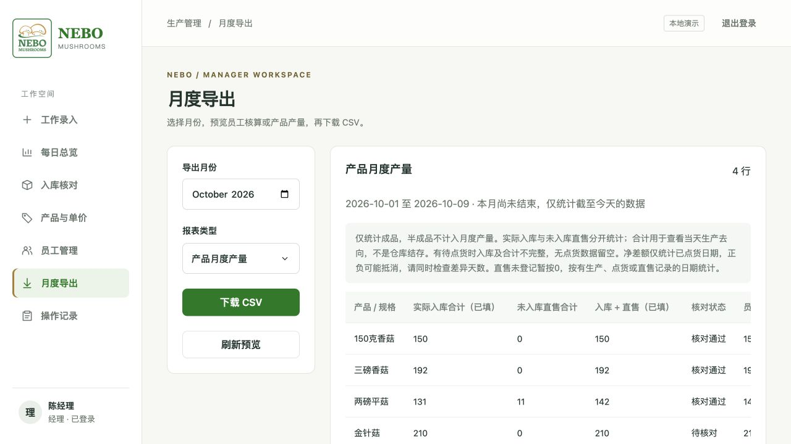

### 7.3 下载 CSV

检查预览后点击左侧 **“下载 CSV”**，下载当前所选报表：

- `员工月度核算-2026-10.csv`
- `产品月度产量-2026-10.csv`

两份分别下载，用 Excel 打开即可。员工报表不包含登录账号、月份列；产品报表也不包含月份列，月份统一通过选择器及下载文件名识别。CSV 含全部列；页面左右滑动可查看未显示的列。每位员工或每种产品只出现一行，不再按每日明细重复列出月度总金额或总工时。

**下载内容与当前预览一致。** 员工修正日报或经理修改直售后，点击“刷新预览”获取最新月度结果再下载。当前月仅统计到今天，完整月份请在结束后重新导出；不能选择未来月份。产品月无数据时会显示空状态并禁用下载。

手机上筛选栏位于预览上方，表格可在自身区域横向滑动，整页不会横向溢出。

报表类型使用与选择框等宽的下拉菜单，支持方向键选择、回车确认及 Escape 关闭。

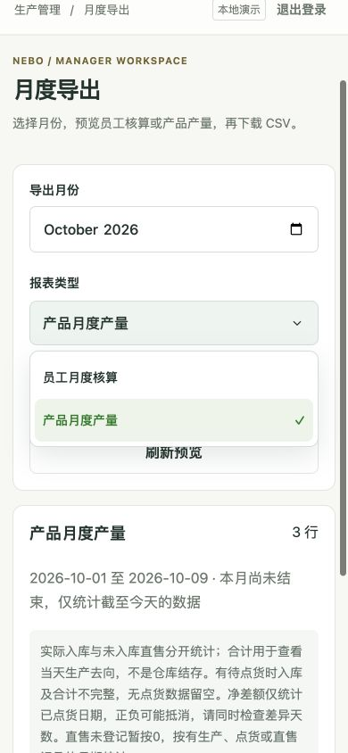

## 8. 经理：维护产品与账号

### 8.1 产品类型、计量单位与计件单价

进入 **“产品与单价”**，点击 **“＋ 添加产品”**，填写产品名称与规格、产品类型、计量单位、每单位单价、启用日期，再保存。成品默认单位“盒”，半成品默认“筐”，可按实际计件单位修改。例如名称填“两磅平菇”或“三磅香菇”，让员工明确选择哪一种规格。

启用日期当天就可以用于录入。当前版本不需要 Lot 编号、每盒蘑菇个数或起始库存。

已有产品可以 **“调整单价”** 或 **“停用”**。调价影响后续新录入；停用后不再用于新日报，但已有日报及相关历史核对仍保留。

为避免历史核算被重新分类，保存后的类型和单位不可修改。需要改变时建立新项目；旧产品默认归为成品，历史单价和金额保持原样。

下图展示添加半成品的表单示例，尚未保存。

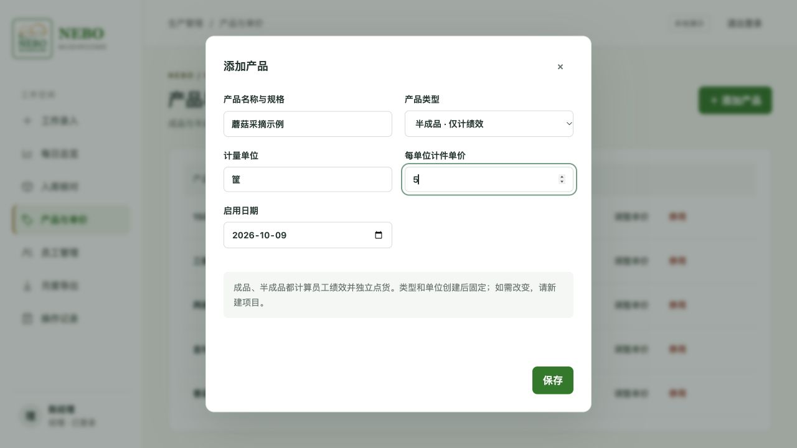

### 8.2 创建和维护账号

进入 **“员工管理”**，点击 **“＋ 添加账号”**，填写姓名、登录名、初始密码、计时时薪，并选择角色后保存。

| 角色选择 | 配置提示 |
| --- | --- |
| 普通员工 | 填写该员工计时工作的时薪，用于计算其计时金额 |
| 点货员 | 只负责独立点货，计时时薪填 0 |
| 经理 | 可查看全体日报、维护资料、导出和核对 |

已有账号点击 **“编辑”**，可修改姓名、计时时薪或重设密码；不需要重设密码时，密码栏留空。时薪调整不自动追改已提交日报的历史金额。


## 9. 经理：追溯操作记录

进入 **“操作记录”**，查看最近 100 次操作，列表显示操作人、操作时间和操作内容。点击 **“查看变更”**，查看操作对象及“原来 / 现在”的对照；修正操作还会记录修改原因。

下图展示李点货首次提交两磅平菇点货：实际入库从“未点货”变为“9盒”，当时员工提交合计为“10盒”。这些是可读的文字和数字，不需要理解程序数据格式。

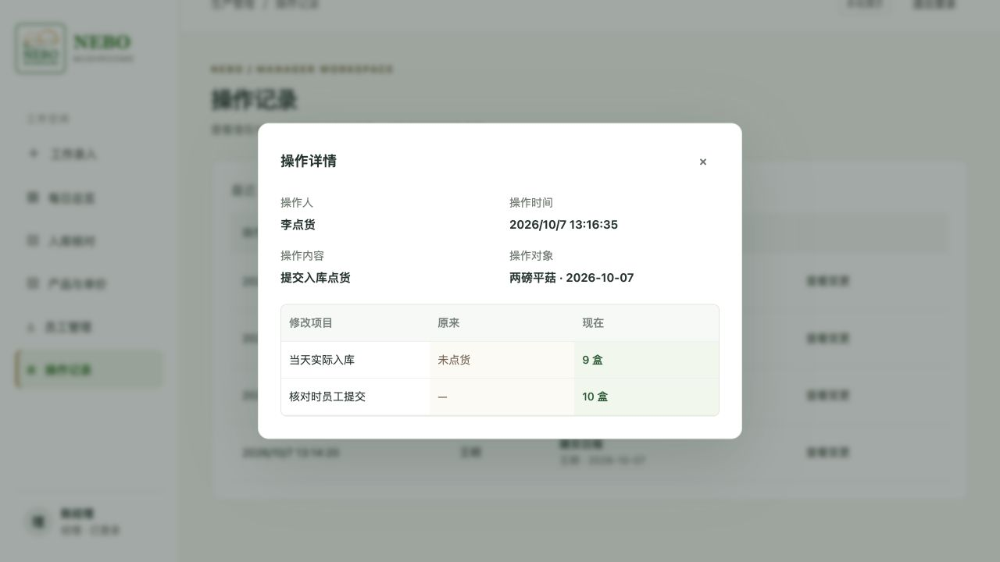

直售登记及修正同样保留操作人、操作时间、原数量、新数量和说明。以下截图对应新增的1盒直售：

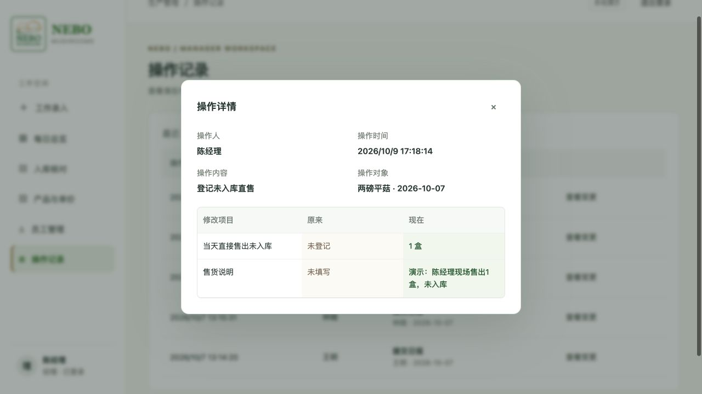

## 10. 本地运行与使用范围

### 启动演示

在项目目录运行，需要 Python 3.11+，无第三方运行依赖：

```sh
python3 -m harvest.server --demo --db data/stages-demo.sqlite3 --port 8767
```

浏览器访问 <http://127.0.0.1:8767>。该演示库包含上述跨天半成品和成品数据；原演示数据库另行保留。


演示账号：`manager`（经理）、`employee`（林晓）、`employee2`（王明）、`checker`（点货员）；演示密码均为 `Harvest2026!`。仅用于本地演示。

### 半成品的手机操作示例

员工每日记录同时展示成品和半成品，以及每项数量、单位、单价和绩效。下图中香菇采摘12筐 × 5.00 = 60.00，已包含在当天总金额201.30中；“数量有差异”来自当天其他产品的点货差异。

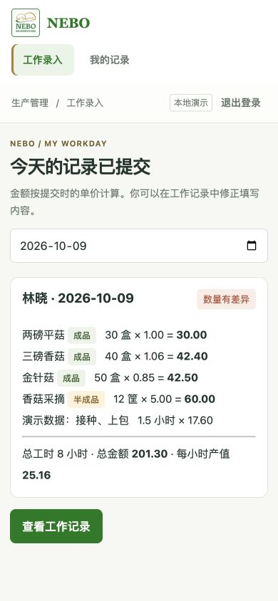

点货员按当天采摘的总筐数填写半成品；次日加工不回头扣减昨天的点货记录。点货员看不到员工报数或绩效，下图是对已填12筐的复核表单，未提交修改。

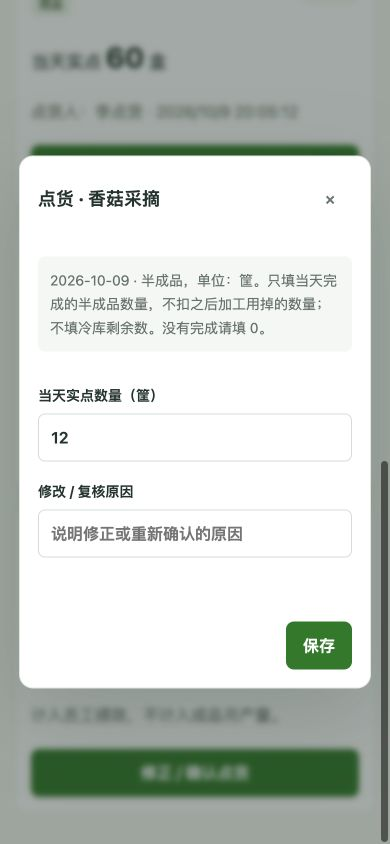

员工月报右侧的工作量按类型和单位分列，避免把筐与盒相加。

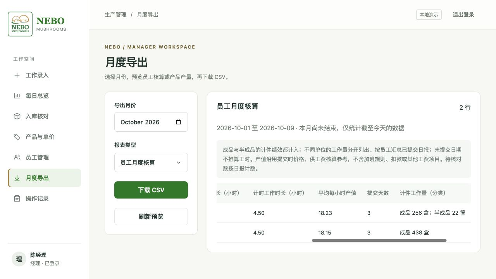
