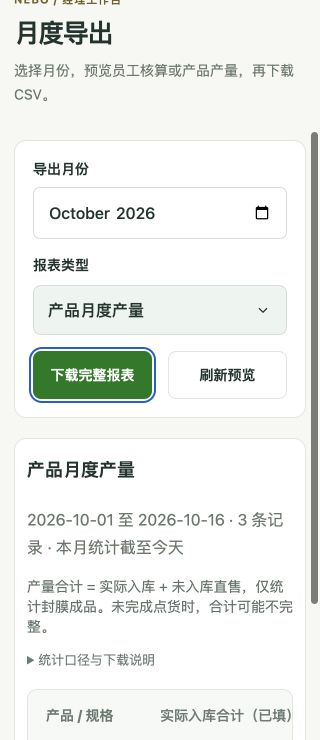
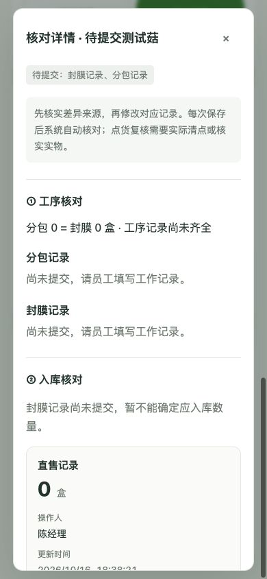
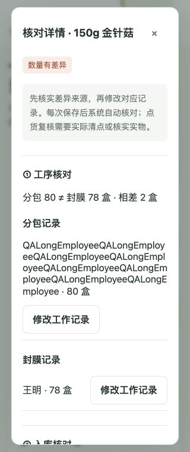
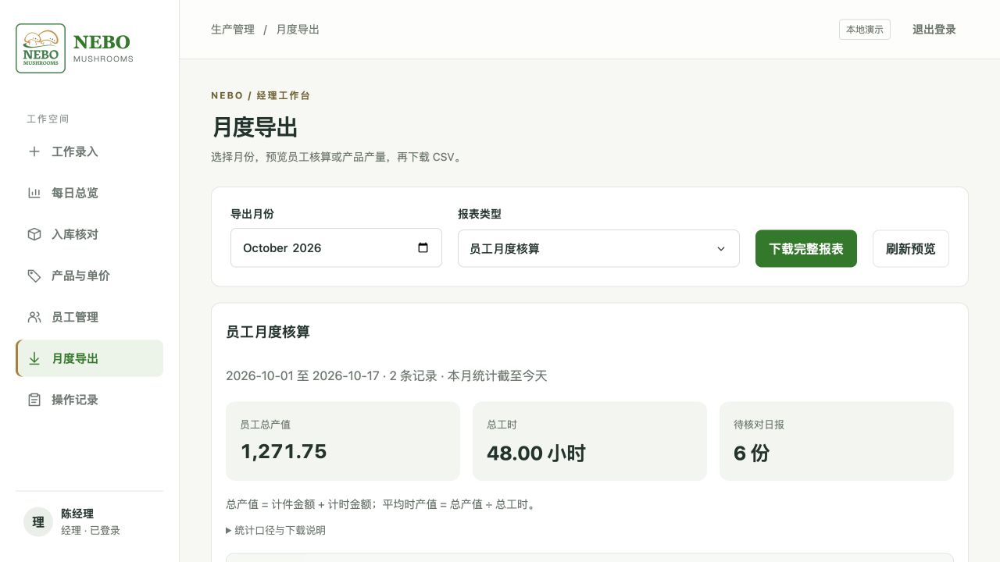
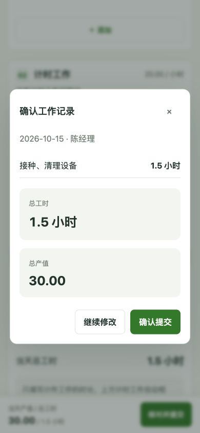

# 桌面与手机输入检查（2026-10-16）

测试使用独立数据库 `/tmp/nebo-input-qa-20261016.sqlite3`，未修改原演示数据库的业务记录。

## 修复内容

- 数字校验禁止溢出、下溢和精度舍入，异常数字返回中文错误，不再误存为零或整数。
- 无效数量、工时不参与实时金额预览，避免显示负产值。
- 清空或输入无效工作日期时恢复原日期，保留表单；日期请求失败不提前清空草稿。
- 无效导出月份恢复原月份，避免日期输入和预览、下载内容不一致。
- 切换新建／已有工序保留新建时填写的单位和单价。
- 停用弹窗禁用真正的提交按钮，防止重复提交；取消按钮不被误禁用。
- 长产品名称自动换行，不再撑宽手机产品页；320px 导出按钮保持单行。

## 验证范围

- Python 44 项测试通过，包括新增极端数字、非法明细回滚、24小时边界测试。
- JavaScript 语法检查及操作日志显示测试通过。
- 实际浏览器操作：1440px 桌面、390px 与 320px 手机视口。
- 经理：工序切换、必填、长名称创建、停用名称确认、月份清空、导出类型切换。
- 员工：负数、小数、重复产品过滤、超过24小时、合法提交与修正、取消恢复标题。
- 点货员：超上限数量拒绝，零数量正常保存。
- 手机表格仅在表格区域横向滚动，页面本身未横向溢出；浏览器未记录 JS 错误。

手机检查为浏览器视口模拟，尚未在真实 iPhone/Android 上验证软键盘和系统日期控件。

## 核对流程后续回归

- 修复只有分包、尚无封膜时，产品月报遗漏待核对项目的问题；员工日报同步显示工序差异。
- 修复无员工记录、点货及直售均为零时，产品月报错误显示核对通过的问题。详情页明确提示记录未齐全。
- 核对状态、报数、点货及签名通过同一数据库读事务获取，避免并发更新时混用不同时间的数据。
- 弹窗提交增加独立的保存中标志，关闭弹窗后返回的错误不再写入其他表单。
- 保存成功但刷新失败时明确提示“已保存”，避免误以为未保存而重复提交；会话失效的表单错误提供提示。
- 员工录入页中的姓名按文本转义显示，特殊字符不再被当成 HTML。
- 47 项 Python 测试、4 项弹窗提交场景测试、操作记录显示测试与 JS 语法检查通过；独立测试库完成手机核对详情和月报页面回测。

## 日期草稿与长姓名回归

- 当前页面会话按日期保留未提交草稿，切换日期后返回可恢复小时数和备注；保存、取消修改或退出登录时清理相应草稿。刷新页面不保留草稿。
- 日期请求返回时检查请求序号和登录用户，避免旧请求覆盖新日期或退出登录后的页面。
- 修复连续英文长姓名撑宽核对详情的问题，并为侧栏姓名、标题说明及记录落款增加换行。
- 日期草稿的同日选择、跨日恢复、请求失败和退出登录竞态测试通过。
- 实际浏览器确认详情桌面宽度与内容宽度均为618px；320px手机视口中弹窗宽度与内容宽度均为280px，页面无横向溢出。测试使用独立数据库。

## 2026-10-17：真实生产流程模拟

使用临时数据库通过业务接口模拟完整流程，未修改演示数据库：

- 前一天采摘12筐；当天两人分包60盒与40盒，另一人封膜100盒，现场直售10盒。
- 点货先录89盒，核对发现差异；重新点货90盒后通过。
- 分包和封膜补记2盒，旧点货窗口提交被拒绝；重新清点92盒后通过。
- 修改计件单价后再修正历史备注，原日报金额不变，核对仍通过。
- 月报实际入库92盒、直售10盒、合计102盒，采摘不重复计入；CSV与预览逐列一致。
- 全部100盒直售时，仍需要点货员明确填写0盒，随后核对通过。

另外使用可控延迟请求模拟慢网络，修复旧刷新响应覆盖新日期或退出登录状态、保存返回后清掉另一日期草稿的问题；日报提交增加重复点击保护。

验证结果：49项Python测试通过（含HTTP权限及会话测试）；JavaScript语法、操作记录显示、弹窗保存、日期草稿、3项刷新竞态和日报保存竞态测试通过。本轮慢网络通过自动化延迟响应模拟，未在真实移动网络设备上测试。

## 界面层级优化

- 手机录入底栏显示产值和总工时，点击“核对并提交”先展示工作明细与汇总，可继续修改或确认提交。
- 入库核对按差异、待复核、待提交排序，已完成项目默认折叠；详情顶部说明差异来源及需要处理的记录。
- 月报增加产值、工时、待核对数量汇总；产品产量分单位计算，表格首列固定。
- 浏览器检查：1280px桌面月报，390px手机确认摘要、已完成2项的折叠和展开，无页面横向溢出；未提交演示业务记录。
- JS语法与既有提交、草稿、刷新测试通过，新增不同单位与缺失数据汇总测试通过。

## 多日角色使用模拟

在独立临时数据库中以员工、点货员、经理身份执行实际业务方法，新增三组连续场景：

- 连续五天生产、直售和点货，第五天回改第二天的分包与封膜数量，验证复点后恢复通过，其他日期不受影响。
- 跨月生产、中间休息一天、调单价及员工时薪，验证两个月分别汇总、休息日不生成日报，历史修正保留原价格。
- 昨天已分包但未录封膜，今天停用产品：复现并修复昨天待核对成品从入库核对与月报消失的问题。停用后仍保留关联分包存在的待核对项目，不恢复员工新录入权限。

52项Python测试与日期草稿、刷新竞态、日报保存、分单位汇总的JavaScript测试通过。上述多日场景为自动化业务层模拟，不等同于员工真机连续试用；现有业务数据库未改动。

## 完整操作历史查询

- 确认原实现仅查询最近100条，数据库没有自动删除历史记录。
- 新增经理专属分页接口，每页50条，支持本地操作日期范围、操作人和类型组合筛选。
- 用125条独立测试记录验证三页无重复、最早记录可访问；翻页期间插入新记录不影响当前查询，重新查询可见新记录。
- 验证本地日期跨UTC午夜的边界、非法参数、空结果以及员工/点货员访问拒绝。
- 55项Python测试、JS语法及操作详情显示测试通过；实际浏览器验证组合筛选、倒置日期提示、重置、历史变更详情。390px手机页面无横向溢出。

### 自动筛选精修

- 移除查询和重置大按钮，任意筛选条件变更后自动请求；有条件时显示轻量的“清除筛选”。
- 请求时保留筛选表单，不重建输入控件；保留请求序号保护，非法日期范围会阻止查询并显示中文提示。
- 浏览器验证：选择产品流程自动得到4条记录，清除后恢复44条；倒置日期显示错误，390px手机无页面横向溢出。JS语法和操作详情测试通过。

## 2026-10-17：统一普通下拉菜单

- 工序设置、已有工序、角色、操作记录筛选、月报类型统一使用自定义选择器；日期和月份保留原生控件。
- 浏览器验证已有采摘选择后单位与单价联动、操作类型自动筛选、月报键盘切换，以及 390px 手机宽度下菜单显示。
- 计件录入选择产品后新增第二项，已选产品不会重复出现。
- 修正通用选择器继承计件网格定位造成的标签错位；桌面截图见 `screenshots/unified-selects.jpg`。
- JavaScript 语法检查及已有前端回归脚本通过。测试未提交业务数据。
